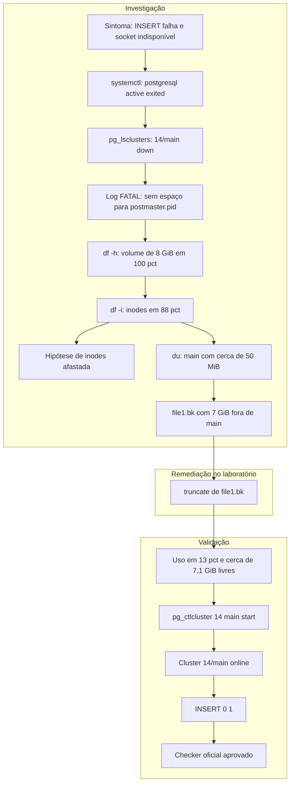
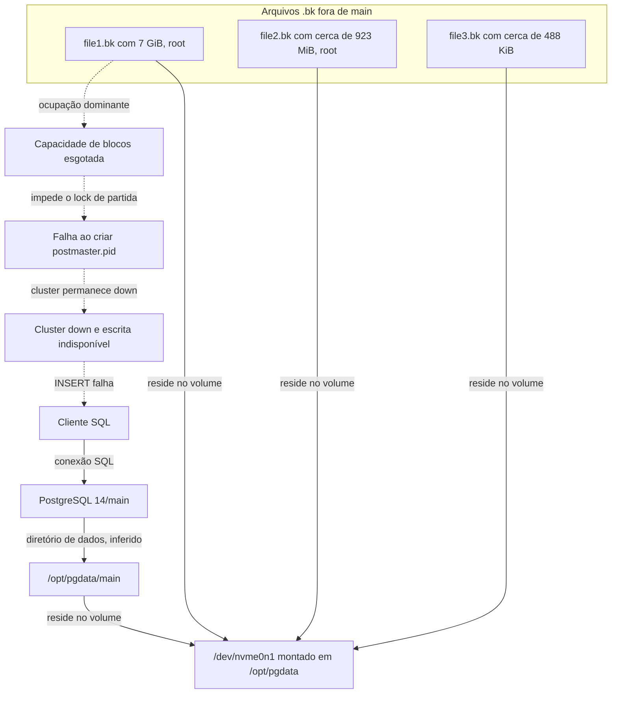

# INC-005 — Manhattan: falha de escrita no PostgreSQL por esgotamento de disco

## Resumo executivo

**Ambiente:** SadServers — Manhattan, Debian 10, PostgreSQL 14, cluster `main`, laboratório simulado e efêmero.

**Dificuldade:** Medium.

**Status:** Resolvido — checker oficial aprovado.

**Severidade:** Não atribuída; ambiente educacional sem impacto de produção.

A inserção em `persons`, no banco `dt`, falhava porque o socket do PostgreSQL não estava disponível. O cluster `14/main` estava `down`. O log registrava `FATAL: could not create lock file "postmaster.pid": No space left on device`. O volume `/dev/nvme0n1`, montado em `/opt/pgdata`, tinha 8 GiB e 100% de uso em blocos. Os inodes estavam em 88% e não esgotados.

O diretório `main` ocupava cerca de 50 MiB. `file1.bk`, com 7 GiB e pertencente a `root`, concentrava a maior parte do volume. No ambiente descartável, `truncate -s 0 /opt/pgdata/file1.bk` devolveu os blocos. O cluster subiu, a inserção retornou `INSERT 0 1` e o checker oficial foi aprovado.

O `truncate` descartou o conteúdo de `file1.bk`. O registro abaixo descreve o que foi executado no laboratório. Essa intervenção não é um procedimento genérico para produção.

## Objetivo e critérios de sucesso

Restabelecer a escrita SQL no PostgreSQL do cenário.

**Critérios de sucesso atendidos:**

- Cluster `14/main` em estado `online`.
- Inserção em `persons` concluída com `INSERT 0 1`.
- Aprovação do checker oficial SadServers.

## Ambiente e componentes

| Componente | Observação |
|---|---|
| Cenário | SadServers — Manhattan: can't write data into database |
| Sistema operacional | Debian 10 |
| PostgreSQL | Versão 14, cluster `main` |
| Cliente inicial | `psql` como usuário `postgres`, banco `dt` |
| Volume | `/dev/nvme0n1`, montado em `/opt/pgdata`, 8 GiB |
| Diretório `main` | `/opt/pgdata/main`, cerca de 50 MiB |
| Arquivos adjacentes | `file1.bk`, `file2.bk` e `file3.bk`, fora de `main` |
| Dificuldade | Medium |

Permanecem sem registro o tipo de sistema de arquivos, as opções de montagem e uma leitura preservada de `data_directory`.

## Linha do tempo (UTC)

Horários absolutos não foram preservados. A tabela registra a ordem da investigação.

| Etapa | Evento |
|---|---|
| T1 | Inserção SQL falha; socket do PostgreSQL indisponível |
| T2 | `systemctl status postgresql` mostra a unidade agregadora `active (exited)` |
| T3 | `pg_lsclusters` mostra `14/main` em `down` |
| T4 | Log com `FATAL` ao criar `postmaster.pid`: sem espaço no dispositivo |
| T5 | `df -h` mostra o volume em 100%; `df -i` mostra inodes em 88% |
| T6 | `du -xhd1 /opt/pgdata` mostra `main` pequeno diante do volume de 8 GiB |
| T7 | Identificação de `file1.bk` com 7 GiB, fora de `main` |
| T8 | `truncate -s 0 /opt/pgdata/file1.bk` no laboratório descartável |
| T9 | Uso do volume cai para 13%, com cerca de 7,1 GiB livres |
| T10 | `sudo pg_ctlcluster 14 main start` conclui com sucesso |
| T11 | Cluster `online`; inserção retorna `INSERT 0 1` |
| T12 | Checker oficial SadServers aprovado |

## Sintomas e impacto observado

O sintoma inicial foi a falha deste comando:

```bash
sudo -u postgres psql -c "insert into persons(name) values ('jane smith');" -d dt
```

A falha ocorreu porque o socket do PostgreSQL não estava disponível. O texto exato do erro do cliente não foi preservado.

No laboratório, o efeito observado foi a impossibilidade de concluir essa escrita e a parada do cluster `14/main`. Não há medição de sessões externas, perda transacional anterior ou impacto fora dessa VM.

A unidade systemd `postgresql` em `active (exited)` coexistiu com o cluster parado. Esse estado não comprovava o funcionamento do cluster.

## Investigação

A consulta à unidade `postgresql` não bastou. `systemctl status postgresql` mostrou a unidade agregadora `active (exited)`. `pg_lsclusters` mostrou o dado que faltava: o cluster `14/main` estava `down`.

O log do PostgreSQL registrou a causa imediata da parada:

```text
FATAL: could not create lock file "postmaster.pid": No space left on device
```

O caminho do arquivo de log e o horário dessa linha não foram preservados. Também não ficou registrado se o `FATAL` veio do boot ou de uma tentativa manual de partida.

`df -h` mostrou `/dev/nvme0n1` montado em `/opt/pgdata`, com 8 GiB e 100% de uso. `df -i` mostrou 88% dos inodes em uso. A mensagem de falta de espaço pode corresponder a blocos ou a inodes; as duas leituras separam o caso. Os inodes não estavam esgotados. Os blocos estavam.

`du -xhd1 /opt/pgdata` mostrou o diretório `main` com cerca de 50 MiB, enquanto o volume ocupava 8 GiB. A ocupação relevante estava fora de `main`. A inspeção do volume encontrou:

- `file1.bk`, em `/opt/pgdata/file1.bk`, com 7 GiB, pertencente a `root`;
- `file2.bk`, com cerca de 923 MiB, pertencente a `root`, fora de `main`;
- `file3.bk`, com cerca de 488 KiB, fora de `main`.

O comando exato da listagem por arquivo, o proprietário de `file3.bk` e os caminhos completos de `file2.bk` e `file3.bk` não foram preservados. A inspeção limitada de conteúdo observou sequências repetitivas em `file2.bk` e bytes iniciais zerados em `file1.bk`. Método, quantidade de bytes lidos e conteúdo restante não foram preservados. Essa leitura não estabelece origem, formato nem validade de backup.

## Evidências

| Evidência | Comando ou fonte | Observação | Limitação |
|---|---|---|---|
| Escrita indisponível | `psql` como `postgres`, banco `dt` | A inserção falhou; o socket não estava disponível | Texto exato do erro do cliente não preservado |
| Unidade systemd | `systemctl status postgresql` | Unidade agregadora `active (exited)` | Esse estado não comprova o processo do cluster |
| Cluster parado | `pg_lsclusters` | `14/main` em `down` | Saída completa, com diretório de dados e log, não preservada |
| Falha de inicialização | Log do PostgreSQL | `FATAL` ao criar `postmaster.pid`: `No space left on device` | Caminho do log e timestamp não registrados |
| Blocos esgotados | `df -h` | `/dev/nvme0n1` em `/opt/pgdata`, 8 GiB, 100% de uso | Tipo de filesystem e opções de montagem não registrados |
| Inodes com folga | `df -i` | 88% dos inodes em uso | Contagem absoluta não preservada |
| `main` pequeno | `du -xhd1 /opt/pgdata` | `main` com cerca de 50 MiB; volume ocupado em 8 GiB | Não detalha, sozinho, o tamanho de cada arquivo |
| `file1.bk` | Inspeção de `/opt/pgdata` | 7 GiB, proprietário `root`, caminho `/opt/pgdata/file1.bk` | Comando exato da listagem por arquivo não registrado |
| `file2.bk` | Inspeção de `/opt/pgdata` | Cerca de 923 MiB, proprietário `root`, fora de `main` | Caminho completo não registrado |
| `file3.bk` | Inspeção de `/opt/pgdata` | Cerca de 488 KiB, fora de `main` | Proprietário e caminho completo não registrados |
| Conteúdo parcial | Inspeção limitada | Sequências repetitivas em `file2.bk`; bytes iniciais zerados em `file1.bk` | Método e extensão da leitura não preservados |
| Espaço recuperado | `df` após o `truncate` | Uso de 100% para 13%; cerca de 7,1 GiB livres | Medição associada à intervenção no laboratório |
| Partida do cluster | `sudo pg_ctlcluster 14 main start` | Comando concluído com sucesso | A partida não substitui a escrita de teste |
| Cluster no ar | `pg_lsclusters` | `14/main` em `online` | Saída completa não preservada |
| Escrita SQL | Inserção em `persons` | `INSERT 0 1` | Uma inserção não audita a integridade do banco |
| Validação oficial | Checker SadServers | Aprovado | Confirma os critérios do exercício |

## Diagrama — diagnóstico e recuperação

O fluxo segue a ordem observada. A ramificação dos inodes registra a hipótese afastada. O `truncate` aparece apenas como ação do laboratório descartável.



## Hipóteses e testes

**Hipótese 1 — O cluster parado explicava o socket indisponível e a falha da inserção.**

Confirmada. `pg_lsclusters` mostrou `down` antes da remediação e `online` depois. A inserção passou a retornar `INSERT 0 1`.

**Hipótese 2 — `active (exited)` da unidade `postgresql` representava um banco em serviço.**

Afastada. A unidade agregadora estava `active (exited)` com o cluster `14/main` em `down`.

**Hipótese 3 — O `FATAL` vinha de esgotamento de inodes.**

Afastada. `df -i` mostrou 88% de uso. Os inodes não estavam esgotados.

**Hipótese 4 — Não havia blocos livres para criar `postmaster.pid`.**

Confirmada pelo `FATAL` com `No space left on device`, por `df -h` em 100% e pela partida bem-sucedida depois da liberação de espaço nesse volume.

**Hipótese 5 — A ocupação estava no diretório `main`.**

Afastada como explicação do volume cheio. `main` tinha cerca de 50 MiB em um volume de 8 GiB.

**Hipótese 6 — `file1.bk` era o ocupante dominante.**

Sustentada pelo tamanho de 7 GiB e pela queda do uso de 100% para 13% depois do `truncate` desse arquivo. A remediação registrada não alterou `file2.bk` nem `file3.bk`.

**Hipótese 7 — Os arquivos `.bk` eram backups íntegros.**

Não confirmada. Nome, tamanho e a inspeção limitada de conteúdo não estabelecem origem, formato ou possibilidade de restauração.

## Causa raiz e fatores contribuintes

**Confirmado:**

- O cluster `14/main` estava `down` e o socket do PostgreSQL não estava disponível.
- O PostgreSQL registrou `FATAL` ao criar `postmaster.pid` por falta de espaço no dispositivo.
- O volume `/dev/nvme0n1`, montado em `/opt/pgdata`, estava com 100% dos blocos em uso.
- Os inodes, em 88%, não estavam esgotados.
- `file1.bk` ocupava 7 GiB nesse volume, fora de `main`, e pertencia a `root`.
- Depois de truncar `file1.bk`, o uso caiu para 13%, o cluster entrou em `online` e a inserção retornou `INSERT 0 1`.

**Inferido:**

- `/opt/pgdata/main` é o diretório de dados do cluster `14/main`. A inferência reúne o nome do cluster, o caminho inspecionado, o volume sem espaço e a recuperação após liberar capacidade nesse volume. Não há leitura preservada de `data_directory` nem da coluna correspondente de `pg_lsclusters`.
- A falta de espaço foi de blocos. `df -h` estava em 100% e `df -i` em 88%, no mesmo contexto do `FATAL`.
- `file1.bk` respondia pela maior parte da ocupação. A capacidade livre depois da intervenção, cerca de 7,1 GiB em um volume de 8 GiB, é compatível com a remoção lógica de um arquivo de 7 GiB. Não houve reconciliação byte a byte.

**Fator contribuinte:**

Arquivos grandes fora de `main` compartilhavam o volume do PostgreSQL. `file2.bk` tinha cerca de 923 MiB. `file3.bk`, com cerca de 488 KiB, não explica o esgotamento.

**Não determinado:**

- Origem, finalidade, data e processo criador dos arquivos `.bk`.
- Se esses arquivos eram backups restauráveis.
- Proprietário de `file3.bk` e caminhos completos de `file2.bk` e `file3.bk`.
- Caminho do log e o instante do `FATAL`.
- Tipo de filesystem, arquivos apagados ainda abertos e outros consumidores não listados.
- Integridade do banco além da inserção testada e do checker.
- Existência de alertas ou monitoramento. A investigação não auditou ferramentas de observação.
- Resultado de um checker executado antes da correção.

## Diagrama — arquitetura e dependências

Seta contínua: relação de composição ou dependência. Seta tracejada: cadeia causal deste incidente. O vínculo do diretório de dados está marcado como inferido.



O desenho representa o host do laboratório. `file2.bk` e `file3.bk` também estavam nesse volume; os caminhos completos desses dois arquivos não foram preservados. A seta causal de ocupação dominante sai de `file1.bk`, único arquivo truncado. A seta contínua que sai do cliente é a dependência da sessão SQL. A seta tracejada que chega ao cliente é a falha observada da inserção.

## Remediação, riscos e rollback

### Remediação executada

No ambiente descartável do laboratório:

```bash
truncate -s 0 /opt/pgdata/file1.bk
```

O comando preservou o nome do arquivo e descartou o conteúdo, devolvendo os blocos ao volume. Em seguida:

```bash
sudo pg_ctlcluster 14 main start
```

A remediação registrada limita-se a esses dois comandos.

### Riscos

- O conteúdo de `file1.bk` foi descartado. Se o arquivo fosse um backup ou outro dado necessário, essa ação não permitiria recuperá-lo.
- Não há cópia prévia documentada.
- O arquivo pertencia a `root`. A mudança dependeu de privilégio administrativo desta VM.
- A finalidade do arquivo seguia sem verificação no momento do `truncate`.
- Em ambiente persistente, o passo anterior é identificar dono, processo e propósito, e preservar ou realocar o conteúdo quando ele puder ser necessário. O `truncate` sem cópia fica restrito a laboratório descartável em que a perda do arquivo seja aceitável.

### Rollback

O conteúdo de `file1.bk` não pode ser restaurado a partir da ação executada. O laboratório era efêmero e foi encerrado depois da validação. Recolocar o cluster em `down` não devolveria os dados do arquivo.

## Validação antes/depois

| Critério | Antes | Depois |
|---|---|---|
| Uso do volume `/opt/pgdata` | 100% | 13% |
| Espaço livre | `FATAL` ao criar `postmaster.pid` | Cerca de 7,1 GiB |
| Cluster `14/main` | `down` | `online` |
| Partida | Log com `FATAL` por falta de espaço | `pg_ctlcluster 14 main start` com sucesso |
| Inserção SQL | Falha; socket indisponível | `INSERT 0 1` |
| Checker SadServers | Sem execução prévia registrada | Aprovado |

**Resultado oficial:**

- Solução correta.
- Tempo de resolução: **13 minutos e 49 segundos**.
- Dicas utilizadas: **0**.
- Pontuação: **2**.

O checker confirma os critérios do laboratório. Ele não demonstra integridade completa do banco, política de retenção nem comportamento em produção.

## Revisão arquitetural — As-Is observado e To-Be proposto

**O To-Be desta seção é proposta arquitetural.** Nenhuma dessas medidas foi implementada no laboratório. A única mudança executada foi truncar `file1.bk` e iniciar o cluster `14/main`.

### As-Is observado

**Dados do PostgreSQL e arquivos `.bk` no mesmo volume.**

`/opt/pgdata/main` e os arquivos `.bk` estavam no volume `/dev/nvme0n1`, montado em `/opt/pgdata`. O diretório `main` ocupava cerca de 50 MiB. `file1.bk` ocupava 7 GiB e `file2.bk` cerca de 923 MiB. Com o volume em 100%, o PostgreSQL não criou `postmaster.pid`. A associação desse lock ao diretório `/opt/pgdata/main` permanece inferida, como na causa raiz.

**Capacidade insuficiente para a inicialização.**

Com 100% dos blocos em uso, o PostgreSQL não criou `postmaster.pid` e registrou `FATAL`. Os inodes ainda tinham folga, em 88%. O esgotamento observado foi de blocos.

**A disponibilidade do serviço depende do armazenamento.**

Com o cluster `down`, o socket não atendeu a inserção. A unidade agregadora `postgresql` permaneceu `active (exited)`. O estado dessa unidade não representava a disponibilidade da escrita.

### To-Be proposto

As medidas abaixo não foram aplicadas nesta VM.

**Separação entre dados transacionais e backups.**

Manter o diretório de dados do PostgreSQL e os arquivos grandes que não pertencem a esse diretório em volumes distintos, com reserva que impeça um arquivo externo de bloquear a criação dos arquivos de partida. A condição de backup dos `.bk` não foi comprovada. A separação se aplica a qualquer arquivo grande que não precise disputar o espaço livre do diretório de dados.

**Retenção e gestão de capacidade.**

Definir retenção, tamanho máximo e responsável pelos arquivos de grande volume, com folga permanente para `postmaster.pid`, WAL e temporários. O volume observado tinha 8 GiB, estava em 100% e continha `file1.bk` com 7 GiB fora de `main`.

**Alertas de blocos e de inodes.**

Alertar o uso de blocos e o uso de inodes do volume de dados. `No space left on device` cobre os dois esgotamentos. Neste caso, somente `df -h` e `df -i` juntos separaram as causas. Não foi observado um alerta prévio; também não se auditou se algum monitoramento existia na VM.

**Disponibilidade e teste funcional de escrita.**

Acompanhar o estado do cluster e a aceitação de conexão, e executar uma escrita funcional periódica. `active (exited)` na unidade agregadora coexistiu com o cluster `down` e não substitui essa verificação.

**Recuperação e gestão de mudanças.**

Em ambiente persistente, a recuperação começa por confirmar blocos e inodes, localizar consumidores fora do diretório de dados, identificar dono e propósito, preservar ou realocar o que for recuperável, registrar a mudança e só então devolver espaço. A validação fecha com a partida do cluster e uma escrita de teste. Não foi criado runbook: o repositório admite procedimento reutilizável somente depois de validação prática, e o To-Be não foi executado.

## Lições aprendidas e ações preventivas

- Unidade systemd agregadora em `active (exited)` pode coexistir com o cluster PostgreSQL parado.
- `No space left on device` pede `df -h` e `df -i`. Aqui os blocos estavam em 100% e os inodes em 88%.
- O diretório `main` pode permanecer pequeno enquanto arquivos vizinhos enchem o volume.
- Liberar espaço restabelece a condição de partida observada. Não identifica quem criou os arquivos.
- `truncate` sem cópia descarta conteúdo e, neste exercício, ficou limitado ao laboratório efêmero.
- `INSERT 0 1` e o checker oficial fecham o critério do cenário. Eles não substituem uma verificação ampla de integridade.
- Os controles do To-Be permanecem proposta. Não houve implementação neste laboratório.

## Referências

- SadServers — cenário Manhattan: can't write data into database.
- Ferramentas Debian do PostgreSQL usadas na investigação: `pg_lsclusters` e `pg_ctlcluster`.
- [Metodologia de investigação](../../docs/methodology.md).
- [Checklist de qualidade dos incidentes](../../docs/incident-quality-checklist.md).
- [Modelo de relatório](../../templates/incident-report.md).
