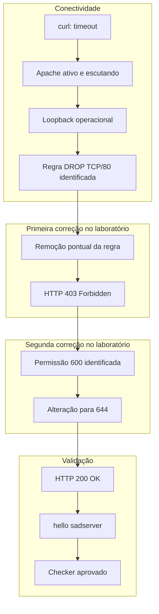
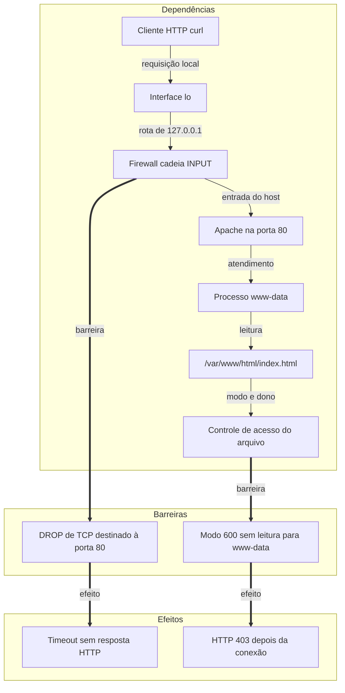

# INC-006 — Tokyo: arquivo web inacessível por firewall e permissão

## Resumo executivo

**Ambiente:** SadServers — Tokyo, Linux, Apache HTTP Server, laboratório simulado e efêmero.

**Dificuldade:** Medium. **Tipo:** Fix.

**Status:** Resolvido — checker oficial aprovado.

**Severidade:** Não atribuída; ambiente educacional sem impacto de produção.

`curl` para `127.0.0.1:80` expirava sem resposta HTTP. O Apache estava `active (running)` e em `LISTEN` na porta 80. O loopback respondia a ICMP. A cadeia `INPUT` tinha uma regra `DROP` para TCP destinado à porta 80.

A remoção dessa regra, no laboratório, permitiu a conexão. O Apache passou a responder `HTTP/1.1 403 Forbidden`. O arquivo `/var/www/html/index.html` estava em modo `600`, pertencente a `root:root`, e os processos `apache2` incluíam o usuário `www-data`. `chmod 644` tornou o arquivo legível sem conceder escrita a outros usuários. O `curl` seguinte retornou `HTTP/1.1 200 OK` e o corpo `hello sadserver`. O checker oficial foi aprovado.

As duas falhas apareceram em sequência. O HTTP 403 só foi observado depois que o descarte de pacotes deixou de impedir a conexão. Nenhuma das duas intervenções é procedimento universal para produção.

## Objetivo e critérios de sucesso

Disponibilizar `/var/www/html/index.html` com o conteúdo `hello sadserver`.

O teste de aceitação do cenário era:

```bash
curl 127.0.0.1:80
```

Resultado esperado:

```text
hello sadserver
```

**Critérios de sucesso atendidos:**

- Conexão TCP estabelecida com `127.0.0.1:80`.
- Resposta `HTTP/1.1 200 OK`.
- Corpo `hello sadserver`.
- Aprovação do checker oficial SadServers.

O limite de tempo do cenário era de 15 minutos. A resolução registrada levou 8 minutos e 25 segundos.

## Ambiente e componentes

| Componente | Observação |
|---|---|
| Cenário | SadServers — Tokyo: Can't Serve Web File |
| Plataforma | Linux; distribuição e versão não registradas |
| Serviço | Apache HTTP Server, unidade `apache2` |
| Cliente | `curl` para `127.0.0.1` na porta 80 |
| Interface | `lo`, com `127.0.0.1/8` |
| Firewall observado | Cadeia `INPUT`; ruleset `nftables` com descarte de TCP/80 |
| Documento | `/var/www/html/index.html` |
| Usuários de processo | `apache2` como `root` e como `www-data` |
| Dificuldade | Medium, tipo Fix |

Permanecem sem registro a configuração do Apache, o log de erro, a policy padrão das cadeias e o backend que relacionava `iptables` a `nftables`.

## Linha do tempo (UTC)

Horários absolutos não foram preservados. A tabela registra a ordem da investigação.

| Etapa | Evento |
|---|---|
| T1 | `curl` expira ao contactar `127.0.0.1:80`; nenhuma resposta HTTP |
| T2 | Apache `active (running)`, com processos e porta 80 em `LISTEN` |
| T3 | Loopback operacional; ICMP com 0% de perda |
| T4 | Regra `DROP` para TCP/80 identificada em `INPUT` e no ruleset `nft` |
| T5 | `iptables -D INPUT 1` remove a regra verificada |
| T6 | A conexão TCP passa a ocorrer e o Apache responde HTTP 403 |
| T7 | `index.html` em modo `600`; leitura como `admin` negada |
| T8 | `chmod 644` no arquivo do laboratório |
| T9 | `curl` retorna HTTP 200 e `hello sadserver` |
| T10 | Checker oficial SadServers aprovado; a plataforma encerra o ambiente |

## Sintomas e impacto observado

O sintoma inicial foi timeout de conexão:

```bash
curl -v --max-time 5 http://127.0.0.1:80/
```

```text
Trying 127.0.0.1:80...
Connection timed out after 5003 milliseconds
curl: (28) Connection timed out
```

A conexão TCP não foi estabelecida. Nenhuma resposta HTTP foi recebida nesse momento.

No laboratório, o efeito observado foi a indisponibilidade desse arquivo para o cliente local. Não há medição de usuários externos, outros destinos, perda de dados ou impacto fora dessa VM.

Depois da primeira intervenção, o sintoma mudou para `HTTP/1.1 403 Forbidden`. Esse segundo sintoma não estava visível enquanto o firewall descartava o TCP/80.

## Investigação

### Conectividade

O timeout de cerca de 5 segundos coincidiu com `--max-time 5`. A reprodução usou `http://127.0.0.1:80/`. O critério de aceitação do cenário estava expresso como `curl 127.0.0.1:80`. Os dois comandos apontam para o mesmo endereço e a mesma porta. A saída completa do comando de aceitação, isolada do `curl` detalhado, não foi preservada.

`systemctl status apache2 --no-pager` mostrou a unidade `active (running)`. `ss -lntp` mostrou a porta TCP 80 em `LISTEN`, com processo Apache associado. Havia processos `apache2`. Serviço em execução e socket em escuta não tornavam o destino acessível ao `curl`.

### Loopback

`ip link show lo` mostrou a interface com flags `LOOPBACK,UP,LOWER_UP`. `ip -br addr` mostrou `127.0.0.1/8`. `ip route get 127.0.0.1` mostrou rota local por `lo`. `ping -c 3 -W 1 127.0.0.1` enviou 3 pacotes, recebeu 3 e registrou 0% de perda.

O ICMP confirmou o loopback. Não demonstrou que o TCP/80 estivesse liberado.

### Firewall

`iptables -L -n -v --line-numbers` mostrou, na cadeia `INPUT`:

```text
1  15  900  DROP  tcp  --  *  *  0.0.0.0/0  0.0.0.0/0  tcp dpt:80
```

A regra 1 descartava TCP destinado à porta 80, de qualquer origem para qualquer destino, em qualquer interface registrada nessa linha. Os contadores marcavam 15 pacotes e 900 bytes.

`nft list ruleset` também apresentava:

```text
tcp dport 80 counter packets 15 bytes 900 drop
```

Os contadores coincidem. A investigação não consultou o backend do `iptables` nem repetiu `nft list ruleset` depois da remoção. Permanece sem prova formal se as duas saídas eram a mesma regra vista por ferramentas diferentes. O efeito observado é o descarte de TCP/80, com pacotes já contabilizados na regra.

Não foi registrada captura de pacotes. A origem de cada um dos 15 pacotes não foi identificada.

### HTTP 403

Após a remoção da regra, o `curl` estabeleceu TCP e recebeu `HTTP/1.1 403 Forbidden`. O corpo dessa resposta 403 não foi preservado.

A inspeção do caminho mostrou:

- `/var`, `/var/www` e `/var/www/html` com modo `755`;
- `/var/www/html/index.html` pertencente a `root:root`, com modo `600`;
- leitura como usuário `admin` respondendo `Permission denied`;
- processos `apache2` executados como `root` e como `www-data`.

O modo `600` concede leitura e escrita ao dono e não concede leitura ao grupo nem aos demais. `www-data` não é `root`. A associação entre o processo que atendeu o `curl` e o usuário `www-data` é a leitura compatível com o modelo usual do Apache e com o resultado posterior. Não houve rastreio do PID que gerou a resposta, nem linha de `ErrorLog`.

O tamanho registrado do arquivo foi 15 bytes. O corpo obtido no HTTP 200 foi `hello sadserver`. Essa combinação é compatível com o conteúdo esperado do cenário. O `cat` como `admin` não exibiu o arquivo.

## Evidências

| Evidência | Comando ou fonte | Observação | Limitação |
|---|---|---|---|
| Timeout inicial | `curl -v --max-time 5 http://127.0.0.1:80/` | `curl: (28)` após 5003 ms; TCP não estabelecido | Não houve resposta HTTP nessa etapa |
| Unidade Apache | `systemctl status apache2 --no-pager` | `active (running)` | Saída completa não preservada |
| Porta 80 | `ss -lntp` | TCP 80 em `LISTEN`, associada ao Apache | PID e endereço exato de bind não preservados |
| Processos | `ss` e `ps` | Processos `apache2` presentes | Lista completa de PIDs não preservada |
| Interface `lo` | `ip link show lo` | Flags `LOOPBACK,UP,LOWER_UP` | Demais interfaces não documentadas |
| Endereço local | `ip -br addr` | `127.0.0.1/8` em `lo` | Saída completa não preservada |
| Rota local | `ip route get 127.0.0.1` | Rota por `lo` | Não testa a policy de TCP |
| ICMP | `ping -c 3 -W 1 127.0.0.1` | 3 enviados, 3 recebidos, 0% de perda | ICMP não representa o TCP/80 |
| Regra `DROP` | `iptables -L -n -v --line-numbers` | Linha 1 de `INPUT`: `DROP` TCP `dpt:80`, 15 pacotes, 900 bytes | Policy e demais regras não preservadas |
| Ruleset `nft` | `nft list ruleset` | `tcp dport 80` com os mesmos contadores e `drop` | Não foi repetido após a remoção |
| Regra removida | Listagem de `INPUT` após `iptables -D` | A regra de bloqueio não aparecia mais | Persistência em disco não testada |
| Conexão após a remoção | `curl` | TCP estabelecido | Comando exato dessa tentativa não preservado |
| HTTP 403 | Resposta do Apache | `HTTP/1.1 403 Forbidden` | Corpo da resposta 403 não preservado |
| Diretórios | `ls -ld` | `/var`, `/var/www` e `/var/www/html` em modo `755` | Donos dos diretórios não registrados |
| Arquivo | `ls -l` | `index.html`, `root:root`, modo `600` | Timestamp não registrado |
| Leitura negada | Tentativa como `admin` | `Permission denied` | Não descreve a leitura feita por `root` |
| Usuários Apache | `ps -eo user,comm` | `apache2` como `root` e como `www-data` | Sem vínculo do PID com a requisição |
| Modo final | `ls` após `chmod` | `-rw-r--r-- 1 root root 15` | Os `...` do registro omitem data e hora |
| HTTP 200 | `curl -i --max-time 5 http://127.0.0.1:80/` | `HTTP/1.1 200 OK` e corpo `hello sadserver` | Cabeçalhos além do status não preservados |
| Validação oficial | Checker SadServers | Aprovado | Confirma os critérios do exercício |

## Diagrama — diagnóstico e recuperação

A ordem é a da investigação. O HTTP 403 entra somente depois da remoção da regra. Corrigir a conectividade revelou a falha de permissão; as duas não foram identificadas ao mesmo tempo.



## Hipóteses e testes

**Hipótese 1 — O Apache estava parado.**

Afastada. A unidade estava `active (running)` e havia processos `apache2`.

**Hipótese 2 — Nada escutava na porta 80.**

Afastada. `ss` mostrou TCP 80 em `LISTEN`, com processo Apache associado.

**Hipótese 3 — O loopback estava inoperante.**

Afastada. `lo` estava `UP,LOWER_UP`, com `127.0.0.1/8`, rota local e ICMP sem perda.

**Hipótese 4 — O sucesso do ICMP liberava o TCP/80.**

Afastada. O `DROP` de TCP/80 coexistiu com o ping bem-sucedido, e o `curl` continuava em timeout antes da remoção da regra.

**Hipótese 5 — Uma regra da cadeia `INPUT` descartava o TCP destinado à porta 80.**

Confirmada. A regra e os contadores foram lidos. Depois de `iptables -D INPUT 1`, a regra saiu da listagem e o `curl` estabeleceu TCP.

**Hipótese 6 — O timeout e o HTTP 403 eram o mesmo defeito.**

Afastada. O 403 só apareceu quando a conexão passou a ser estabelecida. A segunda falha estava encoberta pela primeira.

**Hipótese 7 — Os diretórios impediam a travessia até o arquivo.**

Afastada como explicação do 403. `/var`, `/var/www` e `/var/www/html` estavam em modo `755`.

**Hipótese 8 — O modo do arquivo impedia a leitura pelo atendimento.**

Confirmada pela combinação de modo `600`, dono `root:root`, processos `www-data`, `Permission denied` para `admin` e pela mudança de HTTP 403 para HTTP 200 depois de `chmod 644`, sem outra alteração registrada.

## Causa raiz e fatores contribuintes

**Confirmado:**

- Havia duas causas, em camadas independentes, descobertas em sequência.
- A cadeia `INPUT` descartava TCP destinado à porta 80. Enquanto essa regra vigorou, o `curl` expirou sem resposta HTTP.
- A remoção dessa regra permitiu TCP e revelou `HTTP/1.1 403 Forbidden`.
- `/var/www/html/index.html` estava em modo `600` e pertencia a `root:root`.
- Processos `apache2` executavam como `www-data`, usuário sem leitura nesse modo.
- `chmod 644` produziu `-rw-r--r--` e a resposta passou a `HTTP/1.1 200 OK`, com corpo `hello sadserver`.

**Inferido:**

- As saídas de `iptables` e de `nft` descrevem o mesmo descarte. Os contadores de 15 pacotes e 900 bytes coincidem, mas o backend comum não foi verificado.
- A requisição que recebeu 403 e, depois, 200 foi atendida por um processo `www-data`, não pelo processo `apache2` em `root`. O Apache costuma reservar `root` ao processo pai. Não houve identificação do PID da resposta.
- O arquivo servido foi `/var/www/html/index.html`. O cenário apontava esse caminho, o modo foi alterado nele e o corpo final foi o conteúdo esperado. `DocumentRoot` não foi lido.

**Fator contribuinte:**

Estado `active (running)`, porta em `LISTEN` e ICMP bem-sucedido podiam encerrar o diagnóstico antes do firewall. O timeout, por sua vez, ocultava o 403.

**Não determinado:**

- Distribuição, versão do Linux e versão do Apache.
- Quem criou a regra `DROP` e o modo `600`, e quando.
- Policy padrão, regras além da linha citada e persistência após reboot.
- Se `nft list ruleset` mudou depois de `iptables -D INPUT 1`.
- Origem dos 15 pacotes contabilizados.
- Configuração do virtual host, `DocumentRoot`, `ErrorLog` e corpo do HTTP 403.
- Controles MAC, como AppArmor ou SELinux.
- Grupos do usuário `www-data`.
- PIDs e o processo exato que atendeu o `curl`.
- Existência de monitoramento. A investigação não auditou alertas.
- Resultado de um checker executado antes das correções.

## Diagrama — arquitetura e dependências

Seta contínua: dependência entre componentes observados. Seta grossa: barreira e efeito observado. O desenho mostra as duas barreiras que coexistiam. O efeito HTTP 403 só se tornou visível depois que o `DROP` deixou de impedir a conexão.



O host do laboratório é o único sistema representado. Não há proxy, balanceador nem serviço externo nas evidências. O diagrama também não desenha as demais cadeias do netfilter: a regra observada estava em `INPUT`.

## Remediação, riscos e rollback

### Primeira intervenção

No laboratório, depois de confirmar que a linha 1 de `INPUT` era o `DROP` de TCP/80:

```bash
sudo iptables -D INPUT 1
```

O comando removeu essa regra. A remediação registrada não inclui `iptables -F`, mudança de policy nem desligamento de um serviço de firewall.

**Validação dessa etapa:** a regra não aparecia mais na listagem de `INPUT`. O `curl` estabeleceu TCP. O Apache respondeu `HTTP/1.1 403 Forbidden`.

### Segunda intervenção

```bash
sudo chmod 644 /var/www/html/index.html
```

O modo resultante foi:

```text
-rw-r--r-- 1 root root 15 ... /var/www/html/index.html
```

A alteração concedeu leitura sem conceder escrita a outros usuários. Diretórios e configuração do Apache não foram modificados.

**Validação dessa etapa:**

```bash
curl -i --max-time 5 http://127.0.0.1:80/
```

```text
HTTP/1.1 200 OK

hello sadserver
```

### Riscos

- `iptables -D INPUT 1` apaga a regra que ocupa a posição 1 no instante do comando. Nesta sessão, essa posição foi lida imediatamente antes e era o `DROP` de TCP/80. Em outro momento, a mesma posição pode ser outra regra.
- Remover um descarte expõe o serviço que a regra bloqueava. No laboratório, esse era o objetivo. Em ambiente persistente, a mudança pede registro, revisão e teste de regressão.
- `chmod 644` torna o arquivo legível por qualquer usuário local. Foi adequado ao documento público deste cenário. Não é um modo genérico para arquivos sensíveis.
- As duas mudanças dependeram de privilégio administrativo desta VM.
- Nenhuma das intervenções identifica quem introduziu a regra ou o modo `600`.

### Rollback

A regra removida estava registrada, então poderia ser reinserida. O modo `644` poderia voltar a `600`. Nenhum dos dois retornos foi executado. A plataforma encerrou o ambiente depois da aprovação. Também não foi testado se a regra ou o modo estavam persistidos em disco.

## Validação antes/depois

| Critério | Inicial | Após remover a regra | Após `chmod 644` |
|---|---|---|---|
| TCP para a porta 80 | Timeout | Conexão estabelecida | Conexão estabelecida |
| Resposta HTTP | Nenhuma | `403 Forbidden` | `200 OK` |
| Corpo | Não recebido | Não preservado | `hello sadserver` |
| Regra `DROP` em `INPUT` | Presente, 15 pacotes e 900 bytes | Ausente na listagem | Sem nova listagem |
| Modo de `index.html` | `600` | Sem mudança registrada | `644` |
| Checker SadServers | Sem execução prévia registrada | Sem execução registrada | Aprovado |

**Resultado oficial:**

- Solução correta.
- Tempo de resolução: **8 minutos e 25 segundos**.
- Dicas utilizadas: **0**.
- Pontuação: **2**.

O checker confirma os critérios do laboratório. Ele não demonstra política de firewall, trilha de mudança nem comportamento em produção.

## Architecture Review — As-Is vs. To-Be

**O To-Be desta seção é proposta arquitetural.** Nenhuma dessas medidas foi implementada. As únicas mudanças executadas foram a remoção da regra `DROP` verificada e o `chmod 644` em `/var/www/html/index.html`. Não houve observabilidade nova, infraestrutura como código nem automação de segurança.

### As-Is observado

**Apache ativo e escutando na porta TCP 80.**

A unidade `apache2` estava `active (running)`. A porta 80 estava em `LISTEN`, com processo Apache associado. Esse estado coexistiu com o timeout do cliente.

**Firewall descartando TCP destinado à porta 80.**

A cadeia `INPUT` continha `DROP` para `tcp dpt:80`. O ruleset `nft` mostrava o descarte com os mesmos contadores. O cliente local não estabelecia TCP enquanto a regra permanecia.

**Arquivo servido com permissão incompatível com o usuário de atendimento.**

`index.html` estava em `600`, `root:root`. Havia processo `apache2` como `www-data`. Com a conexão já possível, a resposta era HTTP 403. O modo `644` coincidiu com o HTTP 200.

**Falha de disponibilidade em duas camadas independentes.**

A camada de filtragem impedia a conexão. A camada de permissão do arquivo impedia a leitura. A segunda só pôde ser medida depois da correção da primeira.

### To-Be proposto

As medidas abaixo não foram aplicadas nesta VM.

**Política explícita de firewall e controle de mudanças.**

Registrar a regra, o motivo, o autor e o critério para removê-la. Alterar por especificação da regra, com a posição conferida no momento da mudança. A exclusão por número de linha vale apenas para a listagem recém-lida, como ocorreu neste laboratório.

**Regras mínimas e justificadas.**

Manter descarte apenas do tráfego que a política de fato queira bloquear. Um `DROP` de TCP/80 impede o próprio serviço HTTP publicado nessa porta, inclusive em `127.0.0.1`, como o timeout demonstrou.

**Verificação de permissões na publicação do conteúdo.**

Conferir dono e modo do arquivo e a travessia dos diretórios antes de considerar o deploy concluído. O modo precisa permitir leitura ao usuário que atende a requisição. `644` foi o ajuste deste documento público; o controle proposto é a verificação, não a aplicação cega desse modo a qualquer arquivo.

**Health check HTTP, além do estado do processo.**

`active (running)` e `LISTEN` não detectaram o timeout. Uma sondagem HTTP ao documento esperado teria falhado antes mesmo de distinguir firewall e permissão.

**Monitoramento da conectividade TCP.**

Medir o estabelecimento de conexão com o endereço e a porta publicados. O ICMP do loopback permaneceu saudável durante o `DROP` de TCP/80.

**Alertas de falha HTTP e de indisponibilidade.**

Alertar timeout, conexão recusada e status HTTP diferentes do contrato do serviço. Não foi observado alerta prévio, e a investigação não auditou ferramentas de monitoramento.

**Testes de regressão após firewall e permissões.**

Repetir o `curl` do contrato, aqui `hello sadserver` com HTTP 200, depois de cada mudança de regra ou de modo. A sequência deste laboratório mostra por que um único teste final não separa as camadas: o primeiro teste útil, depois do firewall, ainda retornou 403.

**Runbooks de diagnóstico por camadas.**

A ordem que separou as causas foi processo e escuta, caminho de rede, firewall, status HTTP e permissão do arquivo. Um runbook reutilizável não foi adicionado: o repositório só admite procedimento depois de validação prática, e o To-Be não foi executado.

## Lições aprendidas e ações preventivas

- Unidade `active (running)` e porta em `LISTEN` podem coexistir com timeout do cliente.
- ICMP em `127.0.0.1` não demonstra liberação de TCP/80.
- Um timeout de conexão impede observar o status HTTP que viria em seguida.
- HTTP 403, depois de a conexão passar a existir, é outra falha, não um sinal de que a correção do firewall falhou.
- Diretórios `755` não compensam arquivo `600` para um usuário de atendimento que não é o dono.
- Apagar regra de firewall pelo número da linha exige ler essa linha na hora. O número não é um identificador estável.
- `chmod 644` resolveu a leitura deste documento público no laboratório. Não é uma permissão universal.
- HTTP 200 com o corpo esperado e o checker oficial fecham o critério do cenário. Eles não substituem política de firewall nem trilha de mudança.
- Os controles do To-Be permanecem proposta. Não houve implementação neste laboratório.

## Referências

- SadServers — cenário Tokyo: Can't Serve Web File.
- Comandos usados na investigação: `curl`, `ss`, `systemctl`, `ip`, `ping`, `iptables`, `nft`, `ls`, `ps` e `chmod`.
- [Metodologia de investigação](../../docs/methodology.md).
- [Checklist de qualidade dos incidentes](../../docs/incident-quality-checklist.md).
- [Modelo de relatório](../../templates/incident-report.md).
