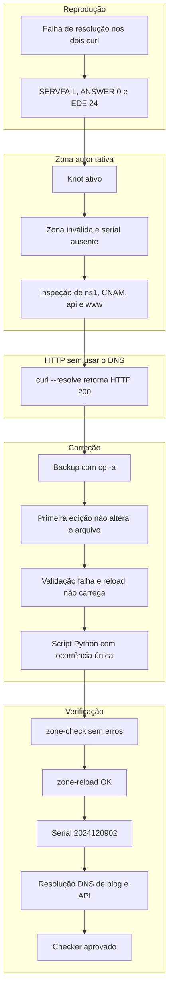
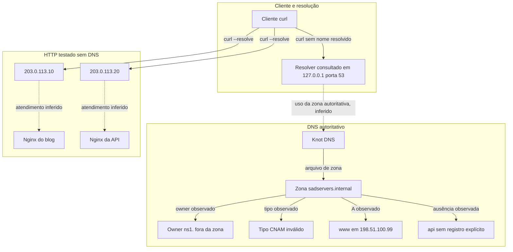

# INC-007 — Sumé: zona DNS inválida impede a resolução dos serviços

## Resumo executivo

**Ambiente:** SadServers — Sumé, Linux, Knot DNS e Nginx, laboratório simulado e efêmero.

**Dificuldade:** Medium.

**Status:** Resolvido — checker oficial aprovado.

**Severidade:** Não atribuída; ambiente educacional sem impacto de produção.

`curl` para `blog.sadservers.internal` e `api.sadservers.internal` falhou com `Could not resolve host`. As consultas `dig` retornaram `SERVFAIL`, `ANSWER: 0` e `EDE: 24 (Invalid Data)`, consultando `127.0.0.1#53`. O Knot estava `active (running)`, mas a zona `sadservers.internal` não carregava: o log apontou erros de parsing nas linhas 13 e 16, e `knotc zone-status` mostrou `serial: -`.

O arquivo `/var/lib/knot/zones/sadservers.internal.zone` tinha owner `ns1.` fora da zona, o tipo inválido `CNAM`, nenhum registro explícito de `api` e `www` em `198.51.100.99`. Com `curl --resolve`, sem alterar o Nginx, o blog respondeu em `203.0.113.10` e a API em `203.0.113.20`. A barreira demonstrada era a resolução DNS.

Depois de um backup com `cp -a`, a primeira edição não alterou o arquivo. Uma validação seguinte ainda falhou, e um reload aceito pelo comando não carregou a zona. Um script Python só gravou a correção depois de verificar que cada trecho aparecia uma única vez. `zone-check` passou, `zone-reload` retornou `OK` e o serial ficou `2024120902`. As consultas locais passaram a resolver blog e API. O checker oficial foi aprovado.

A saída literal dos `curl` finais, já com DNS corrigido, não foi preservada. O aceite funcional do cenário está no checker.

## Objetivo e critérios de sucesso

O cenário pedia:

```bash
curl blog.sadservers.internal
```

```text
Welcome to blog.sadservers.internal
```

```bash
curl api.sadservers.internal
```

```text
{"status": "ok", "service": "api.sadservers.internal"}
```

**Critérios registrados como atendidos:**

- Zona `sadservers.internal` carregada, com serial `2024120902`.
- Resolução local do blog para `www.sadservers.internal.` e `203.0.113.10`.
- Resolução local da API para `203.0.113.20`.
- Aprovação do checker oficial SadServers.

O limite do cenário era de 20 minutos. A resolução registrada levou 10 minutos e 33 segundos.

Os `curl` com `--resolve`, feitos antes da correção DNS, já tinham retornado HTTP 200 e o conteúdo esperado de cada serviço. Eles provam os destinos HTTP. Não substituem a saída dos `curl` que dependem da resolução.

## Sintomas e impacto observado

Os dois `curl` do objetivo falharam com `Could not resolve host`. Nenhuma resposta HTTP foi obtida por esses comandos, porque o nome não foi resolvido.

As consultas `dig` registradas retornaram:

- `SERVFAIL`;
- `ANSWER: 0`;
- `EDE: 24 (Invalid Data)`;
- servidor consultado `127.0.0.1#53`.

No laboratório, o efeito observado foi a impossibilidade de resolver esses dois nomes a partir do resolver local. Não há medição de usuários externos, outros domínios ou impacto fora dessa VM.

O Knot em `active (running)` coexistiu com a zona sem serial carregado. O estado da unidade não demonstrava que a zona estivesse servível.

## Contexto técnico e dependências

| Componente | Observação |
|---|---|
| Cenário | SadServers — Sumé: Tied in a Knot |
| Plataforma | Linux; distribuição e versão não registradas |
| DNS autoritativo | Knot DNS, unidade `knot`, zona `sadservers.internal` |
| Arquivo de zona | `/var/lib/knot/zones/sadservers.internal.zone` |
| Resolver consultado | `127.0.0.1#53` |
| HTTP | Nginx, configurações em `/opt/services/` |
| Endereços locais | `203.0.113.10/32` e `203.0.113.20/32` |
| Nomes do objetivo | `blog.sadservers.internal` e `api.sadservers.internal` |
| Dificuldade | Medium |

O Knot, neste caso, é o servidor autoritativo da zona: o arquivo foi editado, `zone-check` e `zone-reload` atuaram sobre `sadservers.internal`, e o serial passou a aparecer no `zone-status`.

O cliente consultou `127.0.0.1#53`. Esse é o resolver usado pelas consultas. Não ficou registrado se o processo nessa porta era o próprio Knot ou um resolver recursivo à frente dele. As duas funções não se confundem: uma zona autoritativa inválida explica um `SERVFAIL` entregue ao cliente, mas o teste de escuta não foi preservado.

Permanecem sem registro a versão do Knot, o texto integral da zona, as diretivas `listen` do Nginx e o nome das interfaces dos endereços `/32`.

## Linha do tempo (UTC)

Horários absolutos não foram preservados. A tabela registra a ordem da investigação.

| Etapa | Evento |
|---|---|
| T1 | Os dois `curl` falham com `Could not resolve host` |
| T2 | `dig` retorna `SERVFAIL`, `ANSWER: 0`, `EDE: 24` e `127.0.0.1#53` |
| T3 | `systemctl status knot` mostra `active (running)` |
| T4 | Logs: falha ao carregar a zona, parsing nas linhas 13 e 16 |
| T5 | `knotc zone-status` mostra `serial: -` |
| T6 | Leitura da zona: `ns1.` fora da zona, `CNAM`, `api` ausente, `www` em `198.51.100.99` |
| T7 | `curl --resolve` obtém HTTP 200 do blog e da API, sem mudar o Nginx |
| T8 | Backup do arquivo original com `cp -a` |
| T9 | Primeira edição não altera o arquivo; validação falha; reload aceito não carrega a zona |
| T10 | Script Python grava a correção só após ocorrência única de cada trecho |
| T11 | `zone-check` sem erros; `zone-reload` retorna `OK`; serial `2024120902` |
| T12 | Consultas locais resolvem blog e API |
| T13 | Checker oficial aprovado |

## Metodologia de troubleshooting

A sessão seguiu esta sequência, aplicada a este incidente:

reproduzir, identificar a camada, coletar evidências, formular hipótese, testar a hipótese, planejar a correção mínima, preservar o estado, validar, aplicar, verificar e registrar.

A primeira edição quebrou a expectativa de “aplicar e a zona sobe”. O arquivo não mudou, a validação continuou falha e o reload aceito não carregou a zona. A condição para avançar passou a ser uma gravação comprovada, não a aceitação do comando de reload.

### Reproduzir

**Hipótese:** os serviços HTTP não respondiam.

**Evidência:** `curl blog.sadservers.internal` e `curl api.sadservers.internal`.

**Observação:** ambos falharam com `Could not resolve host`.

**Descartado:** não havia, nessa etapa, status HTTP para interpretar. A falha ocorria antes da conexão.

**Decisão:** DEC-001, tratar o problema como resolução de nomes.

**Avanço:** o nome não resolvido justifica consultar o DNS em vez de alterar o Nginx.

### Identificar a camada

**Hipótese:** o resolver local não conseguia responder pela zona.

**Evidência:** consultas `dig`. O comando exato não foi preservado.

**Observação:** `SERVFAIL`, `ANSWER: 0`, `EDE: 24 (Invalid Data)`, servidor `127.0.0.1#53`.

**Descartado:** `NXDOMAIN` não foi o status registrado. `ANSWER: 0` com `SERVFAIL` não é uma resposta vazia bem-sucedida.

**Desconhecido:** o texto completo de cada consulta e se blog e API foram consultados em comandos separados.

**Decisão:** permanecer na camada DNS local.

**Avanço:** o servidor consultado está em localhost, então o próximo passo é o serviço DNS dessa máquina.

### Coletar evidências do Knot

**Hipótese:** o processo autoritativo estava parado.

**Evidência:** `systemctl status knot`, logs e `knotc zone-status`.

**Observação:** unidade `active (running)`. Os logs indicaram falha no carregamento de `sadservers.internal` e erros de parsing nas linhas 13 e 16. O serial inicial era `-`.

**Descartado:** processo parado como explicação do `SERVFAIL`.

**Desconhecido:** caminho do arquivo de log, timestamps e o texto integral das linhas 13 e 16.

**Decisão:** DEC-002, não encerrar o diagnóstico no estado da unidade.

**Avanço:** zona não carregada autoriza a leitura do arquivo, ainda sem editá-lo.

### Formular e testar a hipótese da zona

**Hipótese:** o arquivo de zona continha dados que o Knot se recusava a carregar, e esses dados não correspondiam aos destinos HTTP.

**Evidência:** `/var/lib/knot/zones/sadservers.internal.zone`.

**Observação:**

- `ns1.` era um nome absoluto fora de `sadservers.internal`. O Knot registrou que ignorava esse owner por estar fora da zona.
- `CNAM` era um tipo inválido.
- Não havia registro explícito de `api`.
- `www` apontava para `198.51.100.99`.

**Descartado:** atribuir o erro `invalid address character` ao endereço `10.1.13.4`. As evidências não estabelecem esse vínculo. O descarte registrado do owner fora da zona é `ns1.`.

**Desconhecido:** qual defeito ocupava a linha 13 e qual ocupava a linha 16. O conteúdo original completo da zona não foi preservado.

**Decisão:** DEC-003, corrigir a leitura do parsing por esses achados, não por `10.1.13.4`.

**Avanço:** os defeitos da zona estão nomeados. Falta saber se o HTTP, sozinho, funciona.

### Testar a camada HTTP sem depender do DNS

**Hipótese:** blog e API já respondiam nos endereços locais, e o DNS era a barreira.

**Evidência:** endereços `203.0.113.10/32` e `203.0.113.20/32`; configurações Nginx em `/opt/services/`; testes abaixo, sem modificar o Nginx.

```bash
curl --resolve blog.sadservers.internal:80:203.0.113.10
```

```bash
curl --resolve api.sadservers.internal:80:203.0.113.20
```

**Observação:** os dois testes retornaram HTTP 200. O blog devolveu a mensagem esperada. A API devolveu o JSON esperado. As configurações confirmaram os nomes de servidor do blog e da API.

**Descartado:** Nginx quebrado como causa do `Could not resolve host`.

**Desconhecido:** a transcrição literal desses `curl` e as diretivas `listen`. A associação entre cada IP e o bloco Nginx correspondente é inferida a partir do nome confirmado na configuração e do conteúdo HTTP obtido nesse IP.

**Decisão:** DEC-004, não editar o Nginx.

**Avanço:** o destino do blog fica sendo `203.0.113.10`, e o da API, `203.0.113.20`. O `www` em `198.51.100.99` não é esse destino.

### Planejar a correção mínima

**Hipótese:** um conjunto pequeno de mudanças no arquivo tornaria a zona carregável e apontaria os nomes para os endereços já testados.

**Correção planejada:**

- serial SOA de `2024120901` para `2024120902`;
- owner `ns1.` para `ns1`;
- `www` para `203.0.113.10`;
- `blog` como `CNAME` de `www.sadservers.internal.`;
- `api` como `A` de `203.0.113.20`.

**Desconhecido:** se havia outras alterações necessárias além dessas. O arquivo integral anterior não foi preservado neste relatório.

**Decisão:** DEC-006. Nenhuma alternativa de modelagem, como usar só registros `A`, ficou registrada na sessão.

**Avanço:** o plano está limitado ao que os testes HTTP e a leitura da zona sustentam.

### Preservar o estado

**Hipótese:** a edição precisa ser reversível.

**Evidência:** backup do arquivo original com `cp -a`.

**Observação:** o backup foi feito antes da correção que passou a valer.

**Desconhecido:** o caminho de destino da cópia.

**Decisão:** DEC-005.

**Avanço:** existe uma cópia anterior, embora o caminho não tenha sido anotado.

### Validar a primeira tentativa

**Hipótese:** a primeira edição já teria corrigido a zona.

**Observação:** a primeira tentativa não alterou o arquivo. Uma validação posterior ainda falhou. Um reload aceito pelo comando não carregou a zona.

**Descartado:** aceitação do comando de reload como prova de zona carregada.

**Desconhecido:** o editor usado na primeira tentativa e o nome do comando dessa validação intermediária. O `zone-check` citado mais adiante é o da validação bem-sucedida.

**Decisão:** DEC-007, não seguir com um arquivo que não mudou.

**Avanço:** só uma gravação verificada justifica novo check e novo reload.

### Aplicar com substituição controlada

**Hipótese:** substituir trechos únicos evita gravar a ocorrência errada.

**Evidência:** script Python de substituição. O código não foi preservado.

**Observação:** o script verificava a existência única de cada trecho antes de gravar.

**Desconhecido:** a saída do script e a lista literal dos trechos procurados, além das cinco correções já nomeadas.

**Decisão:** DEC-007, gravar somente com essa verificação.

**Avanço:** a zona pode ser checada de novo.

### Verificar

**Hipótese:** a zona corrigida carrega e responde aos nomes.

**Evidência:** `knotc zone-check sadservers.internal`, `knotc zone-reload sadservers.internal`, `knotc zone-status sadservers.internal` e consultas DNS locais.

**Observação:** check sem erros, reload `OK`, serial `2024120902`. O blog resolveu como `CNAME` para `www.sadservers.internal.` e endereço `203.0.113.10`. A API resolveu para `203.0.113.20`.

**Desconhecido:** a saída literal de `curl blog.sadservers.internal` e `curl api.sadservers.internal` depois dessa resolução.

**Decisão:** DEC-008, não inventar esses `curl`. O checker é o aceite funcional do cenário.

**Avanço:** checker oficial aprovado, em 10 minutos e 33 segundos, sem dicas, com 2 pontos.

## Investigação

O `Could not resolve host` separa este caso de uma falha HTTP. O `dig` localizou a falha em `127.0.0.1#53`, com `SERVFAIL` e `EDE: 24 (Invalid Data)`.

O Knot estava em execução. O carregamento da zona `sadservers.internal` falhou, com parsing nas linhas 13 e 16, e o serial permaneceu `-`. Processo ativo e zona servível são fatos diferentes.

Na zona, `ns1.` ficava fora de `sadservers.internal`, e o Knot ignorava esse owner. `CNAM` não é tipo válido. `api` não tinha registro explícito. `www` usava `198.51.100.99`, endereço distinto de `203.0.113.10`, que depois respondeu pelo blog.

Os testes com `--resolve` mostraram HTTP 200 e o conteúdo esperado, com o Nginx intacto. A resolução era a barreira demonstrada. Os serviços HTTP nos endereços testados estavam funcionais.

## Evidências

| Evidência | Comando ou fonte | Observação | Limitação |
|---|---|---|---|
| Nomes não resolvidos | `curl` dos dois objetivos | `Could not resolve host` | Saída completa não preservada |
| Falha DNS | consultas `dig` | `SERVFAIL`, `ANSWER: 0`, `EDE: 24 (Invalid Data)` | Comando exato não preservado |
| Resolver usado | `dig` | `127.0.0.1#53` | Processo na porta 53 não identificado |
| Unidade Knot | `systemctl status knot` | `active (running)` | Saída completa não preservada |
| Carga da zona | logs do Knot | Falha em `sadservers.internal`; parsing nas linhas 13 e 16 | Texto integral e caminho do log não preservados |
| Serial inicial | `knotc zone-status` | `serial: -` | Saída completa não preservada |
| Owner fora da zona | arquivo de zona e log | `ns1.` absoluto; Knot ignorou o owner | Linha exata não associada |
| Tipo inválido | arquivo de zona | `CNAM` | Owner original desse registro não transcrito |
| `api` ausente | arquivo de zona | Sem registro explícito | Não lista os registros que existiam |
| `www` divergente | arquivo de zona | `198.51.100.99` | Não é o IP do blog confirmado depois |
| Endereços locais | inspeção do host | `203.0.113.10/32` e `203.0.113.20/32` | Interface não registrada |
| Nomes no Nginx | `/opt/services/` | Nomes de servidor do blog e da API | Diretivas `listen` não transcritas |
| Blog sem DNS | `curl --resolve` para `203.0.113.10` | HTTP 200 e mensagem esperada | Transcrição literal não preservada |
| API sem DNS | `curl --resolve` para `203.0.113.20` | HTTP 200 e JSON esperado | Transcrição literal não preservada |
| Backup | `cp -a` | Cópia do arquivo original | Caminho de destino não registrado |
| Primeira edição | comparação posterior do arquivo | O arquivo não mudou | Editor não registrado |
| Reload sem carga | comando de reload | Aceito, mas a zona não carregou | Texto do comando intermediário não preservado |
| Gravação controlada | script Python | Substituição só com trecho único | Código não preservado |
| Zona válida | `knotc zone-check sadservers.internal` | Concluiu sem erros | Saída completa não preservada |
| Recarga | `knotc zone-reload sadservers.internal` | `OK` | Não prova, sozinho, o conteúdo DNS |
| Serial final | `knotc zone-status sadservers.internal` | `2024120902` | Não informa secundários |
| Blog resolvido | consulta DNS local | `CNAME` para `www.sadservers.internal.` e `203.0.113.10` | Saída bruta não preservada |
| API resolvida | consulta DNS local | `203.0.113.20` | Saída bruta não preservada |
| Aceite do cenário | checker SadServers | Aprovado | Não traz a transcrição dos `curl` finais |

## Hipóteses e testes

**Hipótese 1 — O cliente não resolvia os nomes.**

Confirmada. Os dois `curl` retornaram `Could not resolve host`.

**Hipótese 2 — O resolver local respondia com falha, não com uma resposta vazia bem-sucedida.**

Confirmada nas consultas registradas: `SERVFAIL`, `ANSWER: 0` e `EDE: 24 (Invalid Data)` a partir de `127.0.0.1#53`.

**Hipótese 3 — O Knot estava parado.**

Afastada. A unidade estava `active (running)`.

**Hipótese 4 — A zona autoritativa não carregava.**

Confirmada pelos logs de carga, pelos erros de parsing nas linhas 13 e 16 e pelo serial `-`.

**Hipótese 5 — `invalid address character` vinha de `10.1.13.4`.**

Não sustentada. Não há evidência que ligue esse erro a esse endereço. O Knot registrou o descarte do owner `ns1.` por estar fora da zona.

**Hipótese 6 — Os serviços HTTP estavam indisponíveis.**

Afastada nos endereços testados. `curl --resolve` obteve HTTP 200 e o conteúdo esperado, sem mudança no Nginx.

**Hipótese 7 — `198.51.100.99` era o destino HTTP do blog.**

Afastada. O blog respondeu em `203.0.113.10`.

**Hipótese 8 — A primeira edição já tinha corrigido o arquivo.**

Afastada. O arquivo permaneceu inalterado, a validação seguinte falhou e o reload aceito não carregou a zona.

**Hipótese 9 — A substituição controlada produziu uma zona carregável e resolvível.**

Confirmada por `zone-check` sem erros, `zone-reload` `OK`, serial `2024120902` e pelas respostas DNS do blog e da API.

## Registro de decisões técnicas

As alternativas abaixo são as que a sessão chegou a executar ou a afastar com evidência. Onde nenhuma alternativa ficou registrada, a célula diz isso. Recomendações feitas depois da sessão estão na revisão To-Be, não nesta tabela.

| ID | Decisão | Evidência | Alternativa | Justificativa |
|---|---|---|---|---|
| DEC-001 | Tratar a falha como resolução de nomes | `Could not resolve host` nos dois `curl` | Alterar o Nginx nessa etapa. Não foi feito | Sem nome resolvido não há conexão HTTP para diagnosticar |
| DEC-002 | Não encerrar no `active (running)` | Logs de carga e serial `-` | Considerar a unidade ativa como zona servível. Afastado | Processo em execução coexistiu com zona não carregada |
| DEC-003 | Não atribuir `invalid address character` a `10.1.13.4` | Knot ignorou `ns1.` fora da zona; demais defeitos lidos no arquivo | Ligar o erro a `10.1.13.4`. Sem evidência | O owner fora da zona registrado é `ns1.` |
| DEC-004 | Testar HTTP com `--resolve` e manter o Nginx | IPs locais, nomes em `/opt/services/`, HTTP 200 | Editar o Nginx. Não foi feito | Separa aplicação e DNS |
| DEC-005 | Copiar a zona com `cp -a` antes da correção efetiva | Backup do arquivo original | Editar sem cópia. Não foi o caminho seguido | Preserva um estado anterior restaurável |
| DEC-006 | Aplicar serial novo, `ns1`, `www` em `203.0.113.10`, `blog` como `CNAME` e `api` como `A` | Defeitos da zona e destinos HTTP já testados | Outra modelagem de registros. Não registrada na sessão | A mudança cobre os defeitos observados e os IPs que responderam |
| DEC-007 | Trocar a primeira edição por um script Python que exige trecho único | Arquivo inalterado, validação ainda falha, reload sem carga | Continuar após o reload aceito. Afastado | Comando de reload aceito não significou zona carregada |
| DEC-008 | Encerrar a prova funcional do cenário no checker, sem transcrever `curl` final inexistente | DNS resolvido e checker aprovado | Citar uma saída de `curl` final. Não há transcrição | O aceite funcional informado é o checker |

## Diagrama — investigação e decisões

A primeira edição aparece como desvio. Ela não alterou o arquivo, e o fluxo só continua depois da gravação controlada. O checker fecha o cenário. A saída literal dos `curl` finais não faz parte das evidências.



## Causa raiz e fatores contribuintes

**Confirmado:**

- Os clientes não resolviam `blog.sadservers.internal` nem `api.sadservers.internal`.
- O resolver consultado, `127.0.0.1#53`, respondia `SERVFAIL` com `ANSWER: 0` e `EDE: 24 (Invalid Data)`.
- O Knot estava `active (running)`, e a zona `sadservers.internal` não carregava. Havia erros de parsing nas linhas 13 e 16, e o serial era `-`.
- O arquivo de zona tinha `ns1.` fora da zona, o tipo inválido `CNAM`, ausência de registro explícito de `api` e `www` em `198.51.100.99`.
- O Knot ignorava o owner `ns1.` por estar fora da zona.
- Nos testes com `--resolve`, o blog respondeu em `203.0.113.10` e a API em `203.0.113.20`, com HTTP 200 e o conteúdo esperado, sem mudança no Nginx.
- Depois da gravação controlada, a zona passou em `zone-check`, o reload retornou `OK`, o serial ficou `2024120902` e as consultas locais resolveram blog e API para esses endereços.

**Inferido:**

- A zona autoritativa inválida é a origem do `SERVFAIL` visto em `127.0.0.1#53`. O serial `-` antes e as respostas corretas depois do reload sustentam essa leitura. O processo que escutava a porta 53 não foi identificado.
- O tipo `CNAM` estava no registro que a correção transformou em `CNAME` de `blog`. A linha original não foi transcrita.
- O Nginx dos nomes lidos em `/opt/services/` atendeu os `curl --resolve`. O conteúdo e os nomes de servidor coincidem. A diretiva `listen` não foi transcrita.
- A primeira recarga não carregou a zona porque o arquivo ainda não tinha sido alterado. O reload foi aceito mesmo assim.

**Fator contribuinte:**

`active (running)` e um reload aceito podiam ser lidos como sucesso. O serial `-` e a repetição da validação mostraram o contrário. O `www` antigo apontava para um endereço que não era o destino HTTP confirmado do blog.

**Não determinado:**

- Distribuição, versão do Linux e versão do Knot.
- Texto completo da zona e o mapeamento dos defeitos às linhas 13 e 16.
- Vínculo entre `invalid address character` e `10.1.13.4`.
- Se `127.0.0.1#53` era o Knot ou um resolver recursivo.
- Interfaces dos endereços `/32` e diretivas `listen`.
- Caminho do backup, editor da primeira tentativa e código do script Python.
- Saída literal dos `curl` finais, depois da resolução corrigida.
- Secundários DNS, persistência após reboot e autoria da zona inválida.
- Existência de alertas. A investigação não auditou monitoramento.

## Diagrama — arquitetura e dependências

Seta contínua: relação observada. Seta tracejada: relação inferida. O desenho é o estado anterior à correção, com os endereços que os testes HTTP confirmaram.



Não há recursão pública, encaminhador externo nem balanceador nas evidências. A seta tracejada até o Knot não afirma que o binário na porta 53 tenha sido identificado.

## Correção, riscos e rollback

### Correção aplicada

Backup do arquivo original com `cp -a`. O caminho da cópia não foi registrado.

A primeira edição não alterou `/var/lib/knot/zones/sadservers.internal.zone`. A validação seguinte falhou. O reload foi aceito e não carregou a zona.

Em seguida, um script Python substituiu trechos somente quando cada um existia uma única vez. As mudanças gravadas foram:

- serial SOA `2024120901` para `2024120902`;
- owner `ns1.` para `ns1`;
- `www` para `203.0.113.10`;
- `blog` como `CNAME` de `www.sadservers.internal.`;
- `api` como `A` de `203.0.113.20`.

O Nginx não foi modificado.

### Riscos

- Um reload aceito, com arquivo ainda inválido, mantém a zona fora de serviço. Foi o que a primeira tentativa mostrou.
- Gravar o trecho errado altera um registro que não era o alvo. A verificação de ocorrência única reduz esse risco e não elimina um trecho que exista uma vez e ainda assim esteja semanticamente errado.
- Apontar `www` para `203.0.113.10` segue o teste HTTP do laboratório. Não é uma regra para escolher endereços em produção.
- O script e a edição da zona ficaram restritos ao laboratório. Não são o processo de mudança proposto no To-Be.

### Rollback

A cópia feita com `cp -a` poderia ser recolocada no caminho da zona, seguida de nova validação e reload. Esse retorno não foi executado. O caminho da cópia não está no registro, então o rollback não é reproduzível a partir deste relatório. O ambiente de laboratório foi encerrado após o checker.

## Validação antes/depois

| Critério | Antes | Depois da gravação controlada |
|---|---|---|
| `curl` dos nomes | `Could not resolve host` | Saída literal não preservada |
| Consulta DNS | `SERVFAIL`, `ANSWER: 0`, `EDE: 24` | Blog e API resolvidos |
| Blog | Não resolvido | `CNAME` para `www.sadservers.internal.` e `203.0.113.10` |
| API | Não resolvida | `203.0.113.20` |
| Serial | `-` | `2024120902` |
| `zone-check` | Validação intermediária falhou, comando exato não registrado | `knotc zone-check sadservers.internal` sem erros |
| `zone-reload` | Aceito e sem carga da zona | `OK` |
| HTTP com `--resolve` | HTTP 200 e conteúdo esperado | Sem novo teste registrado |
| Checker SadServers | Sem execução prévia registrada | Aprovado |

**Resultado oficial:**

- Solução correta.
- Tempo de resolução: **10 minutos e 33 segundos**.
- Dicas utilizadas: **0**.
- Pontuação: **2**.

O checker confirma os critérios do laboratório, inclusive o contrato dos dois `curl`. Ele não substitui a transcrição ausente desses comandos, nem demonstra operação de DNS em produção.

## Architecture Review — As-Is vs. To-Be

**O To-Be desta seção é proposta arquitetural.** Nenhuma dessas medidas foi implementada. A mudança executada foi a correção do arquivo de zona, depois do backup e da substituição controlada, seguida de check, reload e consultas DNS. Não houve observabilidade nova, pipeline de validação nem automação de publicação.

### As-Is observado

**Resolução local na frente do cliente.**

Os `curl` dependiam de resolver `blog.sadservers.internal` e `api.sadservers.internal`. As consultas foram para `127.0.0.1#53` e receberam `SERVFAIL`.

**Knot autoritativo com a zona inválida.**

A unidade `knot` estava `active (running)`. A zona `sadservers.internal` não carregava. O serial era `-`. O arquivo em `/var/lib/knot/zones/sadservers.internal.zone` continha `ns1.` fora da zona, `CNAM`, `api` sem registro e `www` em `198.51.100.99`.

**HTTP funcional quando o DNS era contornado.**

`203.0.113.10/32` e `203.0.113.20/32` estavam configurados localmente. O Nginx em `/opt/services/` confirmava os nomes. `curl --resolve` obteve HTTP 200 e o conteúdo esperado. A falha de disponibilidade vista pelo `curl` comum estava na resolução, não nesses destinos.

**Autoridade e recursão são papéis diferentes.**

O Knot era a autoridade da zona editada. O cliente usou o resolver em `127.0.0.1#53`. Não foi identificado o processo dessa porta. Uma zona autoritativa que não carrega pode produzir `SERVFAIL` para quem consulta o resolver local, mesmo com o processo `knot` ativo.

**Endereços de documentação.**

`203.0.113.10` e `203.0.113.20` pertencem a `203.0.113.0/24`, o bloco TEST-NET-3 da RFC 5737. No laboratório apareceram como endereços locais `/32`. Não são endereços públicos roteáveis e não devem ser reutilizados como destino de produção. `198.51.100.99` pertence a `198.51.100.0/24`, o bloco TEST-NET-2, também reservado à documentação. Era o alvo antigo de `www`, não o destino HTTP confirmado do blog.

### To-Be proposto

As medidas abaixo não foram aplicadas nesta VM.

**Validação automatizada de zonas.**

Rodar o equivalente a `zone-check` antes de publicar. O parsing das linhas 13 e 16 e o serial `-` mostram uma zona que chegou ao disco sem esse filtro.

**Controle de versão e revisão da mudança.**

A zona foi editada na máquina, com backup local de caminho não anotado. O To-Be guarda o arquivo em revisão, com o diff das cinco mudanças e um segundo olhar antes da publicação. Isso não foi feito no laboratório.

**Verificação do serial SOA.**

Comparar o serial anterior com o novo. Aqui ele saiu de `-`, porque a zona não carregava, para `2024120902`. Um controle de serial evita publicar conteúdo novo com serial que os secundários ignorariam. Não há evidência de secundários nesta VM.

**Testes de resolução DNS.**

Consultar `blog.sadservers.internal` e `api.sadservers.internal` e exigir o `CNAME`, o `A` de `www` e o `A` de `api` observados na validação. `SERVFAIL` com `EDE: 24` seria falha do teste.

**Health check HTTP de ponta a ponta.**

O `curl` do contrato, sem `--resolve`, depende do DNS e do HTTP. O `--resolve` provou só o HTTP. Os dois testes respondem perguntas diferentes. O checker cobre o contrato do cenário; um health check contínuo não foi implantado.

**Monitoramento do carregamento das zonas.**

Alertar zona não carregada e serial ausente. `active (running)` não teria bastado neste caso.

**Alertas de `SERVFAIL` e de indisponibilidade.**

`Could not resolve host` e `SERVFAIL` são o sintoma do cliente. Não foi observado alerta prévio, e a investigação não auditou ferramentas de monitoramento.

**Runbook de DNS por camadas.**

A ordem que separou as causas foi reproduzir o `curl`, ler o `dig`, separar processo e zona, ler o arquivo, provar o HTTP com `--resolve` e só então editar. Um runbook reutilizável não foi adicionado: o repositório só admite procedimento depois de validação prática, e o To-Be não foi executado.

**Rollback e recuperação.**

O rollback é restaurar a cópia, validar e recarregar. Para ser operável, o caminho da cópia, o resultado do check e o serial esperado precisam estar no registro. Neste incidente o backup existiu e o caminho não foi anotado. O retorno não foi executado.

## Lições aprendidas e ações preventivas

- `Could not resolve host` pede diagnóstico de DNS antes de mudança no HTTP.
- `SERVFAIL` com `EDE: 24 (Invalid Data)` e `ANSWER: 0` não é um `NXDOMAIN`.
- Knot `active (running)` pode coexistir com zona não carregada e serial `-`.
- Reload aceito não prova que a zona tenha carregado. O arquivo e o serial precisam ser relidos.
- `ns1.` com ponto final é nome absoluto. Fora de `sadservers.internal`, o Knot ignorou o owner.
- `CNAM` não é um tipo de registro. A correção usada para `blog` foi `CNAME`.
- Um `A` de `www` só serve ao contrato se for o endereço que o HTTP do blog já demonstrou.
- `curl --resolve` testa o serviço sem usar a resolução. Não substitui o `curl` do contrato nem autoriza inventar a saída desse `curl`.
- Os endereços `203.0.113.10` e `203.0.113.20` são TEST-NET-3, usados aqui como endereços locais de laboratório.
- Os controles do To-Be permanecem proposta. Não houve implementação neste laboratório.

## Referências

- SadServers — cenário Sumé: Tied in a Knot.
- Knot DNS — `knotc zone-status`, `knotc zone-check` e `knotc zone-reload`, usados na investigação.
- RFC 5737 — blocos de documentação TEST-NET-2 e TEST-NET-3.
- RFC 8914 — código EDE 24, apresentado pelo `dig` como `Invalid Data`.
- [Metodologia de investigação](../../docs/methodology.md).
- [Checklist de qualidade dos incidentes](../../docs/incident-quality-checklist.md).
- [Modelo de relatório](../../templates/incident-report.md).
