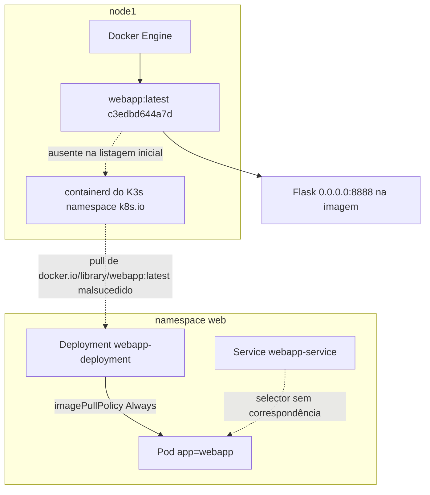
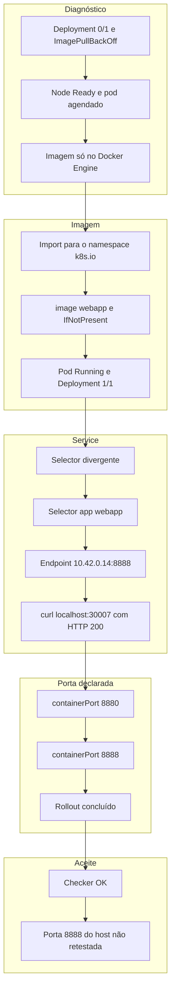

<!-- template: v2 -->

# INC-008 — Singara: aplicação Flask indisponível no K3s

Relatório de laboratório simulado. A primeira linha deste arquivo é o marcador da versão e permanece na primeira linha.

## Resumo executivo

**Ambiente:** SadServers — Singara, Linux, Docker, containerd, K3s e Flask, laboratório simulado e efêmero.

**Dificuldade do laboratório:** Hard.

**Status:** Resolvido — checker oficial aprovado.

**Severidade:** Não atribuída. Não há medição de usuários ou de serviço de produção.

O Deployment `webapp-deployment`, no namespace `web`, estava `0/1`. O pod `webapp-deployment-8684d7d5bf-d25js` permanecia em `ImagePullBackOff`, o Service `webapp-service` não tinha endpoints e a aplicação Flask não estava em execução no Kubernetes.

O nó `node1` estava `Ready` e o pod já havia sido agendado. A imagem `webapp:latest`, ID `c3edbd644a7d`, existia no Docker Engine e não aparecia no runtime do K3s. O Deployment usava `imagePullPolicy: Always` e os eventos registravam falha ao obter `docker.io/library/webapp:latest`.

A imagem foi importada para o containerd do K3s. O manifesto passou a usar `image: webapp` e `imagePullPolicy: IfNotPresent`. Um novo pod ficou `Running`, com Deployment `1/1` e zero reinícios. O selector do Service não coincidia com o rótulo `app=webapp` do pod; depois da correção, o endpoint observado foi `10.42.0.14:8888`. `curl localhost:30007` retornou HTTP 200 antes do rollout final.

A aplicação, lida na imagem, escutava em `0.0.0.0:8888`. O Deployment declarava `containerPort: 8880`. Essa porta foi alinhada para `8888` e o rollout concluiu. O checker `bash /home/admin/agent/check.sh` retornou `OK`. A interface do SadServers confirmou a solução. Tempo oficial: 13 minutos e 35 segundos, sem dicas, com 5 pontos.

O código-fonte da aplicação não foi alterado. O HTTP pelo NodePort não foi repetido depois do rollout final. O último teste à porta 8888 do host retornou `Connection refused` e não foi repetido. A saída integral dos comandos não foi preservada.

## Escopo e critérios de sucesso

**Escopo:** laboratório Kubernetes de nó único (`node1`), namespace `web`. A intervenção ficou restrita a esse ambiente descartável.

**Fora do escopo observado:** usuários reais, outros namespaces, outros nós, carga, reinício do nó e reconstrução do cluster.

**Critérios registrados como atendidos:**

- Imagem `webapp` visível no runtime do K3s.
- Deployment `webapp-deployment` com `READY 1/1` e `AVAILABLE 1`.
- Pod `Running`, com `RESTARTS 0`.
- Endpoint do Service `webapp-service` em `10.42.0.14:8888`.
- HTTP 200 em `curl localhost:30007`, medido antes do rollout final.
- `kubectl rollout status deployment/webapp-deployment -n web --timeout=60s` concluído.
- Checker oficial com saída `OK`.
- Interface do SadServers confirmando a solução.

O limite de tempo do cenário não foi registrado. O tempo oficial registrado foi 13 minutos e 35 segundos.

O HTTP 200 pelo NodePort e o `OK` do checker respondem perguntas diferentes. O primeiro foi uma verificação independente naquele estágio. O segundo é o aceite do laboratório. Nenhum dos dois comprova acesso pela porta 8888 do host depois do rollout final.

## Contexto do sistema

| Componente | Observação |
|---|---|
| Cenário | SadServers — Singara |
| Nó | `node1`, `Ready` |
| Namespace | `web` |
| Deployment | `webapp-deployment`, inicialmente `0/1` |
| Pod inicial | `webapp-deployment-8684d7d5bf-d25js`, `ImagePullBackOff` |
| Rótulo do pod | `app=webapp` |
| Service | `webapp-service`, inicialmente sem endpoints |
| Selector inicial do Service | `app.kubernetes.io/name=webapp` |
| Imagem no Docker Engine | `webapp:latest`, ID `c3edbd644a7d` |
| Referência nos eventos | `docker.io/library/webapp:latest` |
| Política inicial | `imagePullPolicy: Always` |
| Manifestos | `/home/admin/deployment.yaml` e `/home/admin/nodeport.yaml` |
| Aplicação | Flask em `/app/app.py`, `host="0.0.0.0", port=8888` |
| Porta exposta pela imagem | `8888/tcp` |
| `containerPort` inicial | `8880` |
| Runtime do cluster | K3s, imagens consultadas com `k3s ctr` e `k3s crictl` |
| Checker | `bash /home/admin/agent/check.sh` |

O nome do pod criado depois da correção da imagem não foi registrado. O bloco de portas do Service, incluindo `port`, `targetPort` e `nodePort` como escritos no manifesto, não foi transcrito. O teste HTTP usou `localhost:30007`. O endpoint, depois da correção do selector, mostrou a porta `8888`.

Não foram inspecionados Ingress, NetworkPolicy, CNI, registry externo, conteúdo integral dos manifestos nem o processo que atende o checker por dentro do pod.

## Sequência cronológica da investigação

Não há horários absolutos. A ordem abaixo é a das etapas registradas.

1. O estado inicial mostrou Deployment `0/1`, pod em `ImagePullBackOff`, Service sem endpoints e a aplicação inacessível pelo caminho esperado. O container Python ainda não havia iniciado no Kubernetes.
2. `kubectl get deployments,pods,services -n web -o wide`, `kubectl describe pod webapp-deployment-8684d7d5bf-d25js -n web` e `kubectl get nodes -o wide` mostraram nó `Ready`, `PodScheduled=True` e falha ao obter `docker.io/library/webapp:latest`.
3. `docker images`, `sudo k3s ctr images list` e `sudo k3s crictl images` mostraram `webapp:latest` apenas no Docker Engine.
4. A leitura de `/home/admin/deployment.yaml` e `/home/admin/nodeport.yaml`, com `kubectl get endpoints webapp-service -n web -o wide`, mostrou selector divergente, Service sem endpoints e `containerPort: 8880`.
5. `docker image inspect` e `docker run --rm --entrypoint cat webapp:latest /app/app.py` mostraram `8888/tcp` e o Flask em `port=8888`.
6. `docker save webapp:latest -o /tmp/webapp.tar` e `sudo k3s ctr -n k8s.io images import /tmp/webapp.tar` tornaram a imagem visível em `sudo k3s crictl images | grep webapp`.
7. O Deployment foi aplicado com `image: webapp` e `imagePullPolicy: IfNotPresent`. O novo pod ficou `Running`, `1/1`, sem reinícios.
8. O selector do Service foi alterado para `app: webapp`. O endpoint passou a ser `10.42.0.14:8888`.
9. `curl localhost:30007` retornou HTTP 200. Esse teste ocorreu antes do rollout final.
10. `containerPort` foi alterado para `8888`. `kubectl rollout status deployment/webapp-deployment -n web --timeout=60s` concluiu com sucesso.
11. O checker oficial retornou `OK` e a interface do SadServers confirmou a solução.
12. O último teste à porta 8888 do host retornou `Connection refused` e não foi repetido depois do rollout.

## Hipóteses e evidências

| Hipótese | Teste | Observação | Classificação |
|---|---|---|---|
| H1 — o pod não era agendado | `kubectl get`, `kubectl describe pod` e `kubectl get nodes` | Nó `Ready`, `PodScheduled=True`, container em `ImagePullBackOff`, eventos de falha ao obter `docker.io/library/webapp:latest` | Afastada |
| H2 — a imagem estava no Docker Engine e ausente no runtime do K3s | `docker images`, `sudo k3s ctr images list` e `sudo k3s crictl images` | `webapp:latest`, ID `c3edbd644a7d`, presente no Docker e ausente na listagem do K3s; política `Always` | Confirmada |
| H3 — o Service não selecionava o pod | Leitura dos manifestos e `kubectl get endpoints` | Pod com `app=webapp`; Service com `app.kubernetes.io/name=webapp`; nenhum endpoint | Confirmada |
| H4 — a porta declarada no Deployment divergia da porta do processo | `docker image inspect` e leitura de `/app/app.py` | Imagem com `8888/tcp`; Flask em `host="0.0.0.0", port=8888`; Deployment com `containerPort: 8880` | Confirmada |

H1 explica o sintoma inicial apenas até o evento de pull. O pod já tinha nó. H2 explica por que o container não iniciou. H3 explica a ausência de endpoints depois que havia pod para selecionar. H4 é uma inconsistência declarativa confirmada. O HTTP 200 em `localhost:30007` foi obtido antes de corrigir `containerPort`, então essa declaração não era o que impedia o NodePort naquele estágio.

A transcrição completa das saídas não foi preservada. As observações desta tabela são as que foram registradas.

## Causa raiz e fatores contribuintes

Houve três falhas confirmadas, em camadas diferentes. A primeira impedia o container de iniciar. As outras duas permaneciam na configuração declarada.

**Confirmado:** a imagem `webapp:latest` não estava no runtime do K3s, e o Deployment com `imagePullPolicy: Always` tentava obter `docker.io/library/webapp:latest` fora do nó. Esse era o bloqueio imediato do pod.

**Confirmado:** o selector `app.kubernetes.io/name=webapp` não correspondia ao rótulo `app=webapp`. Com o pod em execução, o Service continuava sem endpoints até o selector ser corrigido.

**Confirmado:** `containerPort: 8880` divergia da porta `8888` configurada no Flask e exposta pela imagem. O alinhamento foi necessário para o contrato declarativo e para o checker. Ele não foi a correção que produziu o HTTP 200 já observado no NodePort.

**Inferido:** `containerPort` não publica sozinho a porta no host. `Connection refused` na porta 8888 do host é compatível com a ausência de `hostPort`, mas o manifesto de portas do pod depois do rollout não foi recolhido, e o teste não foi repetido.

**Não determinado:** se `image: webapp`, depois do apply, resolveu para o mesmo ID `c3edbd644a7d`; se o NodePort continuou em HTTP 200 depois do rollout final; se a porta 8888 do host passou a responder; se a imagem importada sobrevive a reinício do nó; qual era o texto completo dos manifestos e do corpo HTTP.

**Fator contribuinte:** política `Always` diante de uma imagem que só existia no Docker Engine; tag `latest` sem digest registrado; rótulos diferentes entre pod e Service; `containerPort` desalinhado do processo. Nenhum defeito no código Flask foi observado. O código não foi modificado.

## Registro de decisões

| ID | Contexto ou hipótese | Evidência utilizada | Decisão | Justificativa | Risco ou trade-off | Resultado observado |
|---|---|---|---|---|---|---|
| DEC-001 | Deployment `0/1` e pod em `ImagePullBackOff` | Nó `Ready`, `PodScheduled=True` e eventos de falha ao obter `docker.io/library/webapp:latest` | Inspecionar os eventos antes de alterar recursos | Evitar correção sem diagnóstico | O tempo de leitura adia a primeira mudança | H1 afastada; o bloqueio ficou na obtenção da imagem |
| DEC-002 | A falha podia estar na imagem ou no agendamento | Listagens do Docker Engine, de `k3s ctr` e de `k3s crictl`, além de `imagePullPolicy: Always` | Comparar o armazenamento do Docker com o do containerd do K3s | Separar imagem local de imagem visível ao Kubernetes | Uma listagem filtrada demais poderia ocultar a imagem; as listagens usadas nessa etapa não foram só um `grep` | `webapp:latest` presente no Docker e ausente no runtime do K3s |
| DEC-003 | O container ainda não explicava Service sem endpoints nem a porta declarada | Manifestos, endpoints vazios, `8888/tcp` e `port=8888` em `/app/app.py` | Examinar os manifestos e o código da imagem | Distinguir configuração declarada do processo real | `docker run` leu a imagem do Docker Engine, não o filesystem de um pod já em execução | Selector divergente e `containerPort: 8880` confirmados |
| DEC-004 | O pull externo de `docker.io/library/webapp:latest` falhava | Imagem local ID `c3edbd644a7d` ausente no K3s | Importar `webapp:latest` com `docker save` e `k3s ctr -n k8s.io images import` | Usar a imagem já presente no nó | Importação manual em `/tmp/webapp.tar`, sem automação e sem prova de persistência após reinício | `crictl images` passou a identificar `webapp` |
| DEC-005 | `Always` continuaria a tentar o pull externo | Imagem já importada e política anterior `Always` | Aplicar `image: webapp` e `imagePullPolicy: IfNotPresent` | Permitir o uso da imagem importada | `IfNotPresent` não atualiza uma imagem local diferente; a referência deixou de ser `webapp:latest` e o digest em execução não foi recolhido | Novo pod `Running`, Deployment `1/1`, `RESTARTS 0` |
| DEC-006 | Service sem endpoints com pod já em execução | Rótulo `app=webapp` e selector `app.kubernetes.io/name=webapp` | Alterar o selector para `app: webapp` | Restabelecer a seleção do pod | A mudança vale para todo pod com esse rótulo; no escopo visto, o rótulo estava no pod do Deployment | Endpoint `10.42.0.14:8888` |
| DEC-007 | `containerPort: 8880` divergia do Flask e do aceite do checker | `8888/tcp`, `port=8888` e HTTP 200 já obtido no NodePort antes dessa mudança | Declarar `containerPort: 8888` e aguardar o rollout | Alinhar o contrato do pod e atender ao checker | O rollout substitui o pod; o NodePort não foi medido de novo depois | Rollout concluído; checker `OK`; porta 8888 do host não retestada |

Não há linha para cada comando de leitura. DEC-001 a DEC-003 registram mudanças de direção. DEC-004 a DEC-007 registram intervenções.

## Remediação e rollback

As quatro intervenções foram aplicadas no laboratório. Nenhuma alterou `/app/app.py`. Não foi registrada cópia dos manifestos antes da edição. Os valores anteriores usados abaixo são os que foram lidos antes de cada mudança, não um arquivo de backup verificado.

### R1 — Importar a imagem para o containerd

```bash
docker save webapp:latest -o /tmp/webapp.tar
sudo k3s ctr -n k8s.io images import /tmp/webapp.tar
sudo k3s crictl images | grep webapp
```

**Executado e validado:** a imagem passou a ser identificada no runtime do K3s.

**Rollback:** não executado. A reversão seria remover a imagem importada do namespace `k8s.io`. Isso não foi testado. O arquivo `/tmp/webapp.tar` não é uma distribuição persistente.

### R2 — Permitir o uso da imagem importada

Em `/home/admin/deployment.yaml`:

```yaml
image: webapp
imagePullPolicy: IfNotPresent
```

```bash
kubectl apply -f /home/admin/deployment.yaml
kubectl get pods -n web -o wide
```

**Executado e validado:** novo pod `Running`, Deployment `1/1`, sem reinícios.

**Rollback:** não executado. A declaração anterior observada era a referência que gerava pull de `docker.io/library/webapp:latest` com `imagePullPolicy: Always`. Reaplicar essa política, com a imagem já importada, não foi testado.

### R3 — Corrigir o selector

Em `/home/admin/nodeport.yaml`:

```yaml
selector:
  app: webapp
```

```bash
kubectl apply -f /home/admin/nodeport.yaml
kubectl get endpoints webapp-service -n web -o wide
```

**Executado e validado:** endpoint `10.42.0.14:8888`.

**Rollback:** não executado. O selector anterior observado era `app.kubernetes.io/name=webapp`.

### R4 — Alinhar a porta declarada

Em `/home/admin/deployment.yaml`:

```yaml
ports:
  - containerPort: 8888
```

```bash
kubectl apply -f /home/admin/deployment.yaml
kubectl rollout status deployment/webapp-deployment -n web --timeout=60s
```

**Executado e validado:** rollout concluído. O checker oficial, em seguida, retornou `OK`.

**Rollback:** não executado. O valor anterior observado era `containerPort: 8880`. Voltar essa declaração recriaria o pod e não foi testado.

O risco comum de R2 e R4 é o `kubectl apply` substituir o pod. O risco de R3 é passar a selecionar outro pod com `app=webapp`. Nenhum outro pod com esse rótulo foi registrado. R1 não altera o código e não torna a imagem disponível para um nó novo.

## Matriz de validação

| Critério de sucesso | Estado inicial | Comando ou método | Resultado após a intervenção | Fonte da evidência | Status | Limitação |
|---|---|---|---|---|---|---|
| Imagem visível no K3s | Ausente em `k3s ctr` e `k3s crictl` | `sudo k3s crictl images \| grep webapp` | `webapp` identificada | Listagem após o import | aprovado | A linha completa e o digest não foram preservados |
| Deployment disponível | `0/1` | `kubectl get` do Deployment | `READY 1/1`, `AVAILABLE 1` | Estado registrado depois de R2 | aprovado | A saída integral não foi preservada |
| Pod em execução | `ImagePullBackOff` | `kubectl get pods -n web -o wide` | `Running`, `RESTARTS 0` | Estado do novo pod | aprovado | O nome desse pod não foi registrado |
| Service encontra o pod | Sem endpoints | `kubectl get endpoints webapp-service -n web -o wide` | `10.42.0.14:8888` | Endpoint depois de R3 | aprovado | `port`, `targetPort` e `nodePort` do manifesto não foram transcritos |
| HTTP pelo NodePort | Aplicação indisponível | `curl localhost:30007` | HTTP 200 | Teste anterior ao rollout final | aprovado | Não repetido depois de R4; corpo da resposta não preservado |
| Rollout de R4 | `containerPort: 8880` | `kubectl rollout status deployment/webapp-deployment -n web --timeout=60s` | Rollout concluído | Status do Deployment | aprovado | Não mede HTTP |
| Checker oficial | Cenário não aceito | `bash /home/admin/agent/check.sh` | `OK` | Checker do laboratório | aprovado | Aceite do cenário; não substitui as linhas independentes |
| Interface SadServers | Cenário em aberto | Confirmação da interface | Solução correta | Interface do laboratório | aprovado | Não descreve qual requisição a interface executou |
| HTTP na porta 8888 do host | Não havia medição inicial preservada | Último teste à porta 8888 do host | `Connection refused` | Teste não repetido após o rollout | inconclusivo | Não comprova nem afasta o estado final |

## Architecture Review — As-Is vs. To-Be

A causa depende de dois armazenamentos de imagem no mesmo nó e do contrato entre Deployment, Service e processo. **O To-Be é proposta.** Nada nesta seção foi implementado só por ter sido escrito.

### As-Is observado

No estado inicial, o Docker Engine tinha `webapp:latest` e o runtime do K3s não a listava. O Deployment pedia pull externo. O pod estava agendado e o container não iniciava. O Service apontava para outro rótulo e não tinha endpoints. Dentro da imagem, o Flask escutava em `8888`; o Deployment declarava `8880`.



A seta contínua é relação observada. A seta tracejada é a falha observada ou o caminho que não se completou. Não há Ingress, registry privado nem segundo nó nas evidências.

A recuperação registrada, na ordem em que foi validada:



O HTTP 200 fica antes da troca de `containerPort`. O checker fica depois do rollout. A porta 8888 do host permanece fora do aceite.

### To-Be proposto

- Distribuir a imagem por um registry alcançável pelo K3s, ou por um import repetível e verificado por digest. A cópia manual em `/tmp` não se repete sozinha na reconstrução do nó.
- Referenciar a imagem por versão ou digest. A tag `latest` não identifica o conteúdo que o pod executou.
- Usar `imagePullPolicy` compatível com essa distribuição. `IfNotPresent` foi a correção do laboratório; não é, por si só, a política adequada a todo ambiente.
- Manter o mesmo rótulo no pod e no selector do Service.
- Declarar `containerPort` igual à porta em que o processo escuta, e distinguir essa declaração de `targetPort`, `port` e `nodePort`.
- Repetir o teste do NodePort depois do último rollout e registrar o resultado da porta do host em separado.
- Não tratar o `OK` do checker como prova de todas as camadas. Execução do container, endpoint, HTTP e critério oficial continuam verificações distintas.

Nenhum desses controles foi implantado. Não foi criado runbook: o repositório só admite procedimento depois de validação prática, e o To-Be não foi executado.

## Lições aprendidas e ações preventivas

- Uma imagem listada pelo Docker Engine não está, por isso, no containerd usado pelo K3s.
- O evento do pod separa falha de agendamento e falha de pull. Neste caso o nó já havia aceito o pod.
- Rótulo do pod e selector do Service são o contrato do endpoint. Nomes parecidos, `app` e `app.kubernetes.io/name`, não se selecionam.
- `containerPort` descreve a porta do container. Não substitui `targetPort`, `port` nem `nodePort`, e não publica a porta no host.
- A recuperação foi por camada: runtime, política da imagem, selector e porta declarada. O HTTP 200 do NodePort ocorreu antes da última dessas camadas.
- O checker oficial e a interface do SadServers fecharam o cenário. Eles não preenchem o teste de host que ficou em `Connection refused`.
- Em ambiente durável, a distribuição da imagem precisa ser automatizada e a referência precisa ser rastreável. Isso permanece proposta.
- As ações preventivas desta seção não foram executadas fora da remediação já validada.

## Limitações

- As saídas completas dos comandos não foram preservadas. O relatório usa as observações registradas.
- O checker aceitou o critério do laboratório. A forma exata da requisição feita pelo checker, descrita como resposta a partir do pod, não teve transcrição própria.
- `curl localhost:30007` foi aprovado antes do rollout de R4 e não foi repetido.
- O último acesso à porta 8888 do host retornou `Connection refused` e não foi repetido depois do rollout.
- A importação manual não foi testada após reinício do nó nem após reconstrução do cluster.
- O ID `c3edbd644a7d` foi lido no Docker Engine. O digest da imagem em execução no pod não foi recolhido.
- Não houve teste de carga, de reinício do pod além do rollout, nem de falha de nó.
- Não há impacto medido fora do laboratório. A dificuldade Hard é classificação do cenário, não severidade operacional.

## Referências

- SadServers — cenário Singara.
- Manifestos lidos no laboratório: `/home/admin/deployment.yaml` e `/home/admin/nodeport.yaml`.
- Aplicação lida na imagem: `/app/app.py`.
- Checker do laboratório: `bash /home/admin/agent/check.sh`.
- [Metodologia de investigação](../../docs/methodology.md).
- [Checklist de qualidade dos incidentes](../../docs/incident-quality-checklist.md).
- [Modelo de relatório v2](../../templates/incident-report.md).
- [Catálogo técnico](../README.md).
