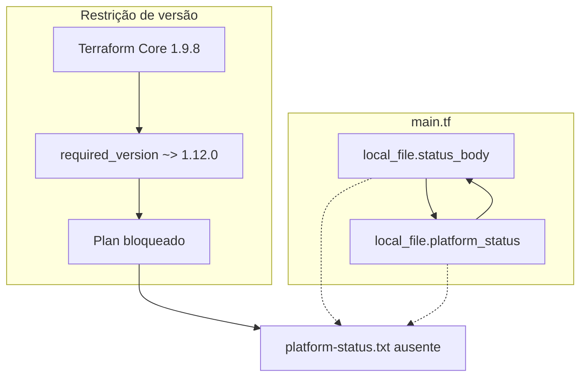
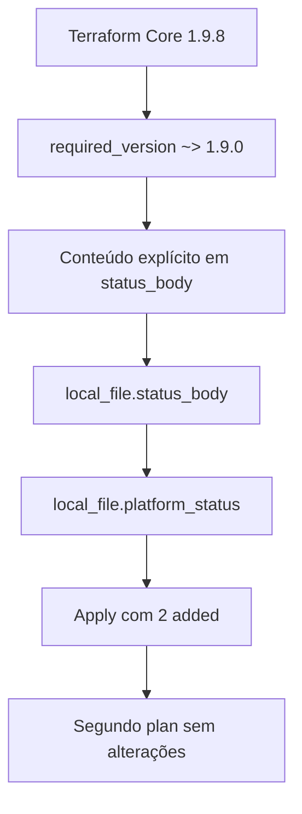

<!-- template: v2 -->

# INC-009 — Parma: falha de validação e publicação de marcador via Terraform

Relatório de laboratório simulado. A primeira linha deste arquivo é o marcador da versão e permanece na primeira linha.

## Resumo executivo

**Ambiente:** SadServers — Parma, Linux, Terraform 1.9.8 e provider `hashicorp/local` 2.5.3. Laboratório simulado e efêmero.

**Status:** Resolvido — solução aprovada oficialmente.

**Severidade:** Não atribuída. Não há medição de usuários ou de serviço de produção.

O projeto em `/home/admin/infra` não executava `terraform plan`. A configuração exigia Terraform `~> 1.12.0` e o executável era 1.9.8. O primeiro comando registrado, `terraform plan -no-color`, retornou `Unsupported Terraform Core version`.

Depois que a restrição passou a `~> 1.9.0`, `terraform validate` retornou `Error: Cycle`. Havia dependência circular entre `local_file.status_body` e `local_file.platform_status`. O arquivo `/var/local/platform-status.txt` estava ausente. `terraform state list` e a busca no projeto não encontraram estado local.

A correção eliminou o ciclo com conteúdo explícito no recurso de origem e declarou `file_permission = "0644"`. O plano previa duas criações e nenhuma destruição. O `apply` criou os dois recursos. `head -n 1` leu `SadServers - Parma OK`. O segundo `terraform plan` retornou `No changes`. A interface do SadServers respondeu `Solution is correct`.

Tempo oficial: 8 minutos e 49 segundos, sem dicas, com 2 pontos. Não há horário absoluto. O checker não foi executado no terminal. A permissão real dos arquivos não foi lida com `stat`. O rollback não foi executado.

## Escopo e critérios de sucesso

**Escopo:** `/home/admin/infra`, em especial `main.tf` e `versions.tf`, os dois recursos `local_file` do provider local, o lockfile e o diretório `/var/local`.

**Fora do escopo registrado:** outros diretórios de estado, histórico de commits, permissão medida no filesystem depois do `apply`, rollback e execução do checker no terminal.

**Critérios registrados como atendidos:**

- Primeira linha de `/var/local/platform-status.txt`: `SadServers - Parma OK`.
- `terraform plan` sem alterações pendentes.
- Solução aprovada pela interface do SadServers.

O limite de tempo do cenário não foi registrado. O tempo oficial registrado foi 8 minutos e 49 segundos.

O `Success!` de `terraform validate`, o plano `2 add`, o `apply` e o `head -n 1` são verificações independentes. A frase `Solution is correct` é o aceite oficial. Ela não substitui essas verificações nem comprova o modo dos arquivos no disco.

## Contexto do sistema

| Componente | Estado inicial |
|---|---|
| Cenário | SadServers — Parma: Debugging Terraform Issues |
| Diretório | `/home/admin/infra` |
| Terraform Core | 1.9.8 |
| `required_version` | `~> 1.12.0` |
| Provider | `hashicorp/local` 2.5.3 |
| Lockfile | `.terraform.lock.hcl` inspecionado |
| Recursos | `local_file.status_body` e `local_file.platform_status` |
| Estado | Não encontrado no projeto |
| Marcador | `/var/local/platform-status.txt` ausente |
| Diretório de destino | `/var/local`, `admin:admin`, modo `755` |
| Arquivo auxiliar citado no plano | `/var/local/.platform-status-body` |

O texto integral inicial de `main.tf` e de `versions.tf` não foi preservado. A configuração final reproduzida mais abaixo foi inferida das edições e do plano, não de uma leitura integral do arquivo depois do `apply`.

Não foram inspecionados backend remoto, workspaces, outros providers nem o histórico Git do laboratório.

## Sequência cronológica da investigação

Não há horários absolutos. A ordem abaixo é a das etapas registradas.

1. `terraform plan -no-color` retornou `Unsupported Terraform Core version`.
2. A leitura de `versions.tf` confirmou `required_version = "~> 1.12.0"`.
3. A leitura de `main.tf` mostrou referências recíprocas entre os dois `local_file`.
4. `terraform state list` não encontrou estado. A busca no diretório do projeto também não encontrou estado local.
5. A verificação de `/var/local` confirmou a ausência de `platform-status.txt`. O diretório era `admin:admin`, modo `755`.
6. `.terraform.lock.hcl` e `terraform version` confirmaram o provider `hashicorp/local` 2.5.3 e o Core 1.9.8.
7. Foram criadas cópias `.bak` de `main.tf` e de `versions.tf`.
8. A restrição foi alterada para `~> 1.9.0`.
9. `terraform validate` passou a apresentar `Error: Cycle`.
10. A referência circular foi substituída por conteúdo explícito no recurso de origem.
11. `terraform validate` retornou `Success!`.
12. O plano mostrou duas criações, nenhuma mudança e nenhuma destruição.
13. A permissão planejada do arquivo auxiliar era `0777`. Ela foi declarada como `0644`.
14. `terraform apply` criou os dois recursos.
15. `head -n 1` em `/var/local/platform-status.txt` retornou `SadServers - Parma OK`.
16. O segundo `terraform plan` retornou `No changes`.
17. A interface do SadServers confirmou `Solution is correct`.

## Hipóteses e evidências

| Hipótese | Teste | Observação | Classificação |
|---|---|---|---|
| H1 — a restrição de versão impedia o Core instalado | `terraform plan -no-color` e leitura de `versions.tf` | Core 1.9.8 e `required_version` `~> 1.12.0`; erro `Unsupported Terraform Core version` | Confirmada |
| H2 — os dois recursos formavam um ciclo | `terraform validate` depois da correção da versão | `Error: Cycle` entre `local_file.status_body` e `local_file.platform_status` | Confirmada |
| H3 — não havia origem independente para o conteúdo | Leitura das referências em `main.tf` | Referências recíprocas no HCL; o marcador também estava ausente no disco | Confirmada |
| H4 — havia estado local a reutilizar | `terraform state list` e busca no projeto | Nenhum estado encontrado nesse escopo | Confirmada no escopo consultado |
| H5 — o diretório de destino impedia a escrita | Modo de `/var/local` e `terraform apply` | Diretório `755` e `apply` criou os dois arquivos | Afastada |
| H6 — o provider local era incompatível com o Core | Lockfile, `terraform validate` e `terraform apply` | Provider 2.5.3; `Success!` e `apply` com 2 added | Afastada neste ambiente |

H1 e H2 são bloqueios independentes. H2 só apareceu no `validate` depois que H1 deixou de interromper o comando. H4 não afirma que não exista estado em outro diretório ou backend. H5 usa o sucesso do `apply` como evidência de que a escrita era possível; não mede o modo dos arquivos criados.

As saídas completas não foram preservadas. A tabela usa as observações registradas.

## Causa raiz e fatores contribuintes

**Confirmado:** dois bloqueios independentes na configuração declarativa. O primeiro era `required_version` `~> 1.12.0` diante do Terraform 1.9.8, e impedia o `plan`. O segundo era a dependência circular entre `local_file.status_body` e `local_file.platform_status`, e impedia o `validate` depois que a versão deixou de bloquear.

**Inferido:** o cenário descreve esses defeitos como efeito de uma refatoração. O histórico de commits não foi examinado, então não há confirmação de quando cada defeito entrou na configuração.

**Não determinado:** por que a configuração exigia Terraform 1.12; se existia estado anterior fora do diretório investigado; o texto integral original do ciclo; o modo real dos arquivos depois do `apply`.

**Fator contribuinte:** a publicação foi tentada sem uma validação que atravessasse a restrição de versão e o grafo. O primeiro erro escondia o ciclo. A permissão `0777` planejada para o arquivo auxiliar não impedia a criação; foi um desvio declarativo corrigido antes do `apply`, não a causa da ausência do marcador.

## Registro de decisões

| ID | Contexto ou hipótese | Evidência utilizada | Decisão | Justificativa | Risco ou trade-off | Resultado observado |
|---|---|---|---|---|---|---|
| DEC-001 | `plan` bloqueado por versão | `Unsupported Terraform Core version` | Ler o HCL antes de editar | Evitar correção só da primeira mensagem de erro | A leitura adia a primeira mudança | As referências circulares foram identificadas em `main.tf` |
| DEC-002 | O ciclo podia depender de estado ou de arquivo já publicado | Referências recíprocas, `terraform state list` e ausência do marcador | Procurar estado e o arquivo de destino antes de reescrever o conteúdo | Não tratar estado existente como ausente | A busca cobriu o projeto; estado em outro local continuaria invisível | Nenhum estado no escopo; `/var/local/platform-status.txt` ausente |
| DEC-003 | O provider podia ser outra incompatibilidade | `.terraform.lock.hcl` e `terraform version` | Confirmar Core e provider antes de trocar o provider | Separar versão do Terraform de versão do provider | Identificar a versão não prova compatibilidade futura | Core 1.9.8 e `hashicorp/local` 2.5.3 |
| DEC-004 | A restrição `~> 1.12.0` não aceitava o executável | Erro de Core e `versions.tf` | Gravar cópias `.bak` e alterar `required_version` para `~> 1.9.0` | Desbloquear a validação com o Core presente | O motivo da exigência 1.12 não é conhecido; a restrição nova acompanha o 1.9 instalado, não um requisito externo verificado | `terraform validate` avançou e retornou `Error: Cycle` |
| DEC-005 | O ciclo não tinha origem de conteúdo | `Error: Cycle` e referências recíprocas | Colocar conteúdo explícito no recurso de origem | Romper o ciclo sem inventar uma terceira fonte | O HCL resultante não foi arquivado por leitura integral do arquivo | `terraform validate` retornou `Success!` |
| DEC-006 | Configuração já válida | `Success!` | Ler o plano antes do `apply` | Ver criação e destruição antes de gravar em `/var/local` | O plano não mostra o modo final medido no disco | 2 add, 0 change, 0 destroy |
| DEC-007 | O plano atribuía `0777` ao arquivo auxiliar | Permissão planejada `0777` | Declarar `0644` e revisar o plano | Evitar publicar o auxiliar com a permissão padrão observada no plano | `0644` foi declarado; `stat` não foi executado depois do `apply` | Plano revisado; `apply` criou os dois recursos |

DEC-001 a DEC-003 mudam a direção do diagnóstico. DEC-004 a DEC-007 são intervenções ou a decisão de aplicar. Não há linha para cada comando de leitura.

## Remediação e rollback

Quatro mudanças foram aplicadas no laboratório: a restrição de versão, a quebra do ciclo, a permissão `0644` e o `apply`. Cópias `.bak` de `main.tf` e de `versions.tf` foram criadas antes das edições. O caminho completo de cada cópia não foi transcrito.

**Rollback não executado.** Restaurar os `.bak` devolveria a restrição `~> 1.12.0` e as referências circulares. Uma reversão operacional precisaria de um plano próprio, inclusive para os arquivos já criados em `/var/local`.

### Versão

```hcl
required_version = "~> 1.9.0"
```

**Executado e validado:** depois dessa edição, o `validate` deixou de acusar versão incompatível e passou a acusar o ciclo.

### Conteúdo e permissão

O bloco abaixo é a configuração resultante **inferida** das edições e do plano. Não é uma leitura integral final de `main.tf`.

```hcl
resource "local_file" "status_body" {
  filename        = "/var/local/.platform-status-body"
  content         = "SadServers - Parma OK\n"
  file_permission = "0644"
}

resource "local_file" "platform_status" {
  filename        = "/var/local/platform-status.txt"
  content         = local_file.status_body.content
  file_permission = "0644"
}
```

`platform_status` passa a depender de `status_body` em um único sentido. O conteúdo explícito está em `status_body`. Os dois recursos declaram `0644`. Antes dessa declaração, o plano mostrava `0777` no arquivo auxiliar.

**Executado e validado:** `terraform validate` retornou `Success!`. O plano ficou em 2 add, 0 change e 0 destroy. `terraform apply` criou os dois recursos. A primeira linha do marcador foi `SadServers - Parma OK`. O plano seguinte retornou `No changes`.

O `No changes` mostra convergência entre configuração e estado do Terraform. Não substitui `stat`.

## Matriz de validação

| Critério de sucesso | Estado inicial | Comando ou método | Resultado após a intervenção | Fonte da evidência | Status | Limitação |
|---|---|---|---|---|---|---|
| Configuração válida | `plan` bloqueado por versão e, depois, `Error: Cycle` | `terraform validate` | `Success!` | Saída registrada do validate | aprovado | Transcrição completa não preservada |
| Plano sem destruição | Marcador ausente e sem estado no projeto | `terraform plan` | 2 add, 0 change, 0 destroy | Plano anterior ao apply | aprovado | Não mede o arquivo no disco |
| Aplicação | Arquivos de destino ainda não criados pelo Terraform | `terraform apply` | 2 added | Saída registrada do apply | aprovado | Flags adicionais do comando não foram transcritas |
| Primeira linha do marcador | `/var/local/platform-status.txt` ausente | `head -n 1` | `SadServers - Parma OK` | Leitura do arquivo publicado | aprovado | Não descreve as linhas seguintes |
| Estado convergente | Plano inicial não chegou a propor criação | Segundo `terraform plan` | `No changes` | Plano depois do apply | aprovado | Convergência do Terraform, não `stat` |
| Aceite oficial | Cenário em aberto | Interface do SadServers | `Solution is correct` | Interface do laboratório | aprovado | O checker não foi executado no terminal |
| Permissão no filesystem | Plano do auxiliar em `0777`; diretório `755` | `stat` | Não executado | Declaração `0644` e plano convergente | não executado | A declaração não comprova o modo lido no disco |
| Rollback | Cópias `.bak` existentes | Restauração | Não executado | Backups criados e não restaurados | não executado | Restaurar os `.bak` reintroduziria os dois defeitos |

## Architecture Review — As-Is vs. To-Be

A publicação do marcador dependia do Core aceitar a restrição e de o grafo dos dois `local_file` ter uma origem de conteúdo. **O To-Be é proposta.** Nada nesta seção foi implementado só por ter sido escrito.

### As-Is observado

No estado inicial, Terraform 1.9.8 encontrava `~> 1.12.0` e o `plan` parava. No HCL, `status_body` e `platform_status` se referenciavam. O marcador não estava em `/var/local`. O ciclo só foi confirmado pelo `validate` depois da troca da restrição.



A seta contínua é a relação observada. A seta tracejada liga o ciclo ao marcador ausente: os recursos não publicavam o arquivo, e a confirmação do ciclo veio depois da correção da versão. Não há backend remoto nem outro workspace nas evidências.

### Estado recuperado

Este fluxo é o que foi executado e validado. Não é proposta.



`platform_status` consome `status_body.content`. Os dois declaram `0644` na configuração inferida. O aceite da interface fica fora deste desenho porque não descreve qual verificação ela executou.

### To-Be proposto

- Validar, fora do apply manual, que a restrição de versão aceita o Core do ambiente.
- Executar `terraform fmt`, `terraform validate` e `terraform plan` antes de publicar, para que um erro de versão não esconda um ciclo.
- Reavaliar se os dois `local_file` precisam existir para o mesmo texto. Nesta correção, os dois foram mantidos.
- Declarar `file_permission` e conferir o modo com `stat` depois do `apply`.
- Definir onde o estado é guardado e como ele é protegido. Neste laboratório ele não foi encontrado no projeto.
- Em ambiente durável, exigir revisão do plano antes do `apply`. O plano deste caso foi lido e não teve destruição; isso não vira controle permanente.

Nenhum desses controles foi implantado. Não foi criado runbook: o repositório só admite procedimento depois de validação prática, e o To-Be não foi executado.

## Lições aprendidas e ações preventivas

- Corrigir a incompatibilidade de versão revelou o ciclo. O primeiro erro não era o único defeito.
- `Unsupported Terraform Core version` vem da restrição declarada e do executável. Não diz nada sobre o grafo dos recursos.
- Referência recíproca entre `local_file` não oferece origem para o conteúdo. O conteúdo explícito ficou no recurso de origem; o outro passou a lê-lo.
- Ausência de estado no diretório do projeto não prova ausência de estado em outro backend.
- Diretório `755` e `apply` bem-sucedido afastam a hipótese de destino não gravável. Não medem a permissão dos arquivos criados.
- `0777` no plano do auxiliar era o valor planejado antes da declaração `0644`. Declarar a permissão não substitui `stat`.
- `validate`, `plan`, `apply`, leitura do marcador e segundo `plan` respondem perguntas diferentes. `No changes` é convergência do estado.
- `Solution is correct` fecha o exercício. Não foi acompanhado de checker no terminal e não representa uma arquitetura de produção.
- As ações do To-Be permanecem proposta.

## Limitações

- Não há horários absolutos nem histórico de commits da configuração.
- O texto original do ciclo e a leitura integral final de `main.tf` não foram preservados. O bloco HCL da remediação é inferido.
- `head -n 1` confirma a primeira linha exigida pelo critério. Não descreve o restante do arquivo.
- `stat` não foi executado. A permissão `0644` está na configuração inferida e no plano convergente, não numa leitura do filesystem.
- As cópias `.bak` não foram restauradas. O caminho completo delas não foi transcrito.
- Não se procurou estado fora do projeto investigado.
- O checker não foi executado no terminal. A aprovação oficial é a mensagem `Solution is correct` na interface do SadServers.
- Não há impacto medido fora do laboratório.

## Referências

- SadServers — Parma: Debugging Terraform Issues.
- Arquivos do laboratório: `/home/admin/infra/main.tf`, `/home/admin/infra/versions.tf` e `.terraform.lock.hcl`.
- Destino publicado: `/var/local/platform-status.txt`.
- [Metodologia de investigação](../../docs/methodology.md).
- [Checklist de qualidade dos incidentes](../../docs/incident-quality-checklist.md).
- [Modelo de relatório v2](../../templates/incident-report.md).
- [Catálogo técnico](../README.md).
