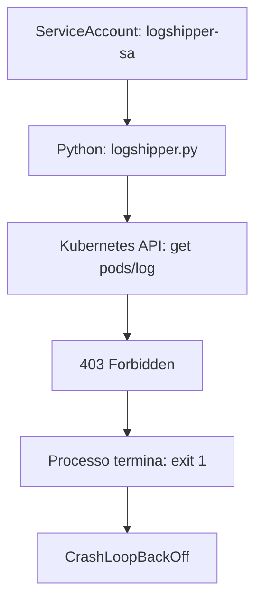
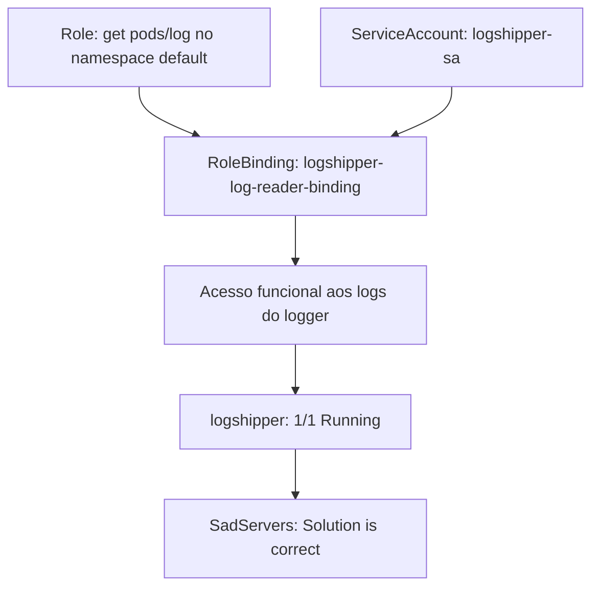

<!-- template: v2 -->

# INC-010 — Buenos Aires: CrashLoopBackOff por autorização RBAC insuficiente

Relatório de laboratório simulado. A primeira linha deste arquivo é o marcador da versão e permanece na primeira linha.

## Resumo executivo

**Ambiente:** SadServers — Buenos Aires, Kubernetes/K3s, aplicação Python, namespace `default`. **Dificuldade:** Medium. **Tipo:** Fix.

**Status:** resolvido — aceite oficial `Solution is correct`. **Severidade:** não atribuída, pois não houve impacto de produção medido.

O pod `logshipper` apresentava `0/1 CrashLoopBackOff` e encerrava seu processo Python com código 1. Os logs do aplicativo registraram HTTP `403 Forbidden` na chamada `CoreV1Api->read_namespaced_pod_log`, indicando que a identidade `system:serviceaccount:default:logshipper-sa` não podia executar `get` em `pods/log` no namespace `default`. A listagem de Roles e RoleBindings desse namespace estava vazia.

Foram criados uma Role com `get` em `pods/log` e um RoleBinding para a Service Account. O pod passou a `1/1 Running` e seus logs mostraram repetidamente a leitura das mensagens do `logger`. A interface SadServers aprovou a solução em **5 minutos e 50 segundos**, **sem dicas**, com **2 pontos**. A definição Kubernetes do pod `logshipper` não foi alterada por nossos comandos.

**Ressalva:** o teste `kubectl auth can-i get pods/log --as=...` retornou `no` mesmo após a criação dos recursos RBAC. A causa dessa divergência não foi determinada; a leitura efetiva de logs pelo aplicativo e o aceite oficial são evidências independentes de recuperação funcional.

## Escopo e critérios de sucesso

**Escopo:** pods `logger` e `logshipper` no namespace `default`, Service Account `logshipper-sa`, acesso do aplicativo Python à API de logs Kubernetes e RBAC namespaced.

**Restrição explícita:** não modificar a definição Kubernetes do pod `logshipper`.

**Critérios oficiais:** `logshipper` permanece `Ready` (`true`) e sua especificação não é alterada. O cenário recomenda aguardar cerca de dois minutos após iniciar a VM e 30 segundos de estabilidade antes de acionar o checker.

**Critérios adicionais da investigação:** explicar a falha por evidências do processo, confirmar o acesso funcional aos logs do `logger`, limitar privilégios e obter o aceite oficial.

## Contexto do sistema

| Componente | Observação |
|---|---|
| Namespace | `default` |
| Pod produtor | `logger-6f7fb76c9f-p44hb`, inicialmente `1/1 Running` |
| Pod consumidor | `logshipper-597f84bf4f-fb5t2`, inicialmente `0/1 CrashLoopBackOff` |
| Imagem do consumidor | `logshipper:v3`, presente no nó |
| Processo | `/usr/bin/python3 logshipper.py` |
| Identidade | `system:serviceaccount:default:logshipper-sa` |
| Nó | `node1` |
| Acesso negado | API Kubernetes, verbo `get`, sub-recurso `pods/log`, namespace `default` |
| Recursos RBAC iniciais | `kubectl get roles,rolebindings -n default -o yaml` retornou `items: []` |
| Remediação | Role `logshipper-log-reader`; RoleBinding `logshipper-log-reader-binding` |

O pod `logshipper` era controlado por ReplicaSet. Não foram examinados manifests completos do Deployment, ClusterRoles, ClusterRoleBindings, políticas de admission, auditoria da API ou o código-fonte Python.

## Sequência cronológica da investigação

Os horários absolutos da investigação não foram coletados. Os timestamps de infraestrutura presentes no `describe` não representam o horário de cada decisão.

1. `kubectl get pods -o wide`: `logger` em `1/1 Running`; `logshipper` em `0/1 CrashLoopBackOff`, com cinco reinicializações na primeira consulta.
2. `kubectl describe pod -l app=logshipper`: imagem presente, container iniciado, última execução terminada com `Exit Code: 1`, e eventos `BackOff`. Service Account identificada como `logshipper-sa`.
3. Tentativa de `kubectl logs -l app=logshipper --previous --tail=60` falhou na recuperação do container anterior; a saída do terminal apareceu misturada com a linha do comando seguinte. Não foi usada para determinar a causa.
4. `kubectl get serviceaccount logshipper-sa -o yaml` confirmou a existência da identidade no namespace `default`, sem demonstrar suas autorizações.
5. `kubectl logs logshipper-597f84bf4f-fb5t2 -c logshipper --tail=80` revelou `CoreV1Api->read_namespaced_pod_log: (403)`, `Forbidden`, com negação explícita de `get` em `pods/log` para a Service Account.
6. `kubectl auth can-i get pods/log --as=system:serviceaccount:default:logshipper-sa -n default` retornou `no`.
7. `kubectl get roles,rolebindings -n default -o yaml` retornou `items: []`.
8. Foi criada a Role `logshipper-log-reader` com verbo `get` e recurso `pods/log` no namespace `default`.
9. Foi criado o RoleBinding `logshipper-log-reader-binding`, associando a Role à Service Account `default:logshipper-sa`.
10. A consulta `kubectl auth can-i ...` repetida retornou `no`, mas `kubectl get pods -l app=logshipper -w` mostrou `1/1 Running`, com nove reinicializações acumuladas.
11. `kubectl describe role` e `kubectl describe rolebinding` confirmaram a regra `pods/log`/`get` e o sujeito `ServiceAccount logshipper-sa default`.
12. `kubectl logs -l app=logshipper --tail=30` mostrou repetidamente `Thanks for fixing me! Logger is saying:` seguido da mensagem produzida pelo `logger`.
13. Foi solicitado `kubectl get pods -l app=logshipper; sleep 30; kubectl get pods -l app=logshipper`. A transcrição recebida preservou somente uma consulta, com `1/1 Running` e nove reinicializações, última havia 3m38s.
14. A interface SadServers exibiu `Solution is correct`, duração 5m50s, zero dicas, dois pontos, e informou que desligaria o servidor.

## Hipóteses e evidências

| Hipótese | Teste | Observação | Classificação |
|---|---|---|---|
| H1 — falha do processo Python | `kubectl describe pod`; logs do container | `Exit Code: 1` e exceção da API Kubernetes | Confirmada como mecanismo do crash |
| H2 — autorização insuficiente para leitura de logs | Logs Python; `kubectl auth can-i` inicial | HTTP 403 e negação explícita de `get pods/log`; teste inicial `no` | Confirmada |
| H3 — inexistência de Role/RoleBinding namespaced | `kubectl get roles,rolebindings -n default -o yaml` | `items: []` | Confirmada no namespace consultado |
| H4 — erro de download de imagem | `kubectl describe pod` | Imagem `logshipper:v3` presente; container criado e iniciado | Afastada para o crash observado |
| H5 — falha de agendamento | `kubectl get pods`; `describe` | Pod agendado em `node1`, processo iniciado | Afastada para o crash observado |
| H6 — divergência entre `can-i` posterior e execução funcional | Repetição de `can-i`; logs do aplicativo | `no` após RBAC, mas leitura funcional do `logger` | Confirmada como divergência; causa não determinada |

O `items: []` refere-se apenas a Roles e RoleBindings namespaced; não comprova ausência de ClusterRoles ou ClusterRoleBindings. O retorno `no` após a correção não permite concluir, sozinho, que o aplicativo continuava sem autorização.

## Causa raiz e fatores contribuintes

**Confirmado:** o aplicativo `logshipper` encerrava com erro após a API Kubernetes negar a operação `get` no sub-recurso `pods/log` para `system:serviceaccount:default:logshipper-sa`. A falta dessa autorização era suficiente para explicar o erro `403` observado e o `CrashLoopBackOff`. A concessão de RBAC namespaced foi seguida por recuperação funcional e aceite oficial.

**Inferido:** a exceção da API não era tratada de maneira que mantivesse o processo ativo; a evidência de `Exit Code: 1` e o traceback sustentam essa interpretação, mas o código Python não foi inspecionado.

**Não determinado:** motivo histórico da ausência do RBAC; existência e conteúdo de regras RBAC cluster-scoped; causa do `no` no `kubectl auth can-i` posterior; comportamento após reconstrução da VM; lógica completa do cliente Python.

**Fator contribuinte:** o processo dependia de autorização Kubernetes para acessar logs de outro pod, mas o namespace não tinha Role/RoleBinding namespaced antes da intervenção. Não foi demonstrado se essa era a única forma possível de conceder acesso no ambiente.

## Registro de decisões

| ID | Contexto ou hipótese | Evidência utilizada | Decisão | Justificativa | Risco ou trade-off | Resultado observado |
|---|---|---|---|---|---|---|
| DEC-001 | Container em CrashLoopBackOff | `describe`, `Exit Code: 1`, imagem presente | Investigar logs e identidade antes de alterar objetos | Separar falha de processo de falha de agendamento ou imagem | Logs anteriores podem não estar disponíveis | Identidade identificada; primeira tentativa de logs falhou |
| DEC-002 | Falha na recuperação dos logs anteriores | Erro de `--previous`; Service Account existente | Consultar logs do container atual e testar autorização | Buscar a mensagem efetiva do aplicativo | `can-i` isolado não prova causa | 403 explícito e `can-i: no` |
| DEC-003 | Negação de `get pods/log` | Traceback e teste inicial | Inspecionar RBAC namespaced antes de criar regras | Evitar duplicação ou alteração desnecessária | Escopo cluster-scoped não foi inspecionado | `items: []` |
| DEC-004 | Falta de permissão comprovada | 403, Role/RoleBinding ausentes no namespace | Criar Role `get pods/log` e vinculá-la somente a `logshipper-sa` | Corrigir sem modificar a definição do pod, com privilégio restrito a verbo e sub-recurso | Acesso a logs de qualquer pod no namespace; possível exposição de dados nos logs | Role e RoleBinding criados |
| DEC-005 | `can-i` ainda retornava `no`, mas pod estava Ready | `can-i: no`; `1/1 Running` | Inspecionar Role, RoleBinding e logs funcionais, sem ampliar permissões | Não confundir um teste contraditório com falha comprovada do aplicativo | Divergência permaneceu sem explicação | Regras corretas e mensagens do `logger` lidas pelo aplicativo |
| DEC-006 | Aplicação recuperada | Logs funcionais e `1/1 Running` | Manter RBAC criado e solicitar estabilidade e checker | Validar resultado sem novas mudanças | Segunda leitura após `sleep 30` não foi preservada | Interface oficial aprovou o cenário |

## Remediação e rollback

Foram executados os comandos abaixo no namespace `default`:

```bash
kubectl create role logshipper-log-reader \
  --verb=get \
  --resource=pods/log \
  -n default

kubectl create rolebinding logshipper-log-reader-binding \
  --role=logshipper-log-reader \
  --serviceaccount=default:logshipper-sa \
  -n default
```

Ambos retornaram confirmação de criação. `kubectl describe role` mostrou `pods/log` e `[get]`; `kubectl describe rolebinding` mostrou a Role e o sujeito corretos. Nenhum comando `kubectl edit`, `kubectl apply` ou alteração de especificação do pod foi executado na investigação registrada.

**Rollback:** não executado. Em um ambiente persistente, a remoção dos dois objetos criados poderia ser avaliada após revisão de dependências, por exemplo com `kubectl delete rolebinding logshipper-log-reader-binding -n default` e `kubectl delete role logshipper-log-reader -n default`. Isso revogaria a autorização concedida e provavelmente reintroduziria a falha; não é uma ação recomendada enquanto o aplicativo depender desse acesso. Esses comandos são **proposta de reversão**, não comandos executados.

**Trade-off de segurança:** a Role permite ler logs de pods do namespace `default`, não apenas do `logger` atual. Não foi usado `resourceNames`, pois o nome do pod `logger` inclui sufixo gerado pelo Deployment e pode mudar em recriações. Essa decisão evita vincular o funcionamento a um nome efêmero, mas amplia o alcance de leitura dentro do namespace. Em produção, seria necessário avaliar isolamento, retenção e sensibilidade dos logs.

## Matriz de validação

| Critério de sucesso | Estado inicial | Comando ou método | Resultado após a intervenção | Fonte da evidência | Status | Limitação |
|---|---|---|---|---|---|---|
| Regra RBAC declarada | Nenhuma Role namespaced listada | `kubectl describe role logshipper-log-reader` | `pods/log`, verbo `get` | Saída do terminal | aprovado | Não verifica regras cluster-scoped |
| Identidade vinculada | Nenhum RoleBinding namespaced listado | `kubectl describe rolebinding ...` | Service Account `logshipper-sa` no namespace `default` | Saída do terminal | aprovado | Não inspeciona demais bindings do cluster |
| Teste independente de autorização | `no` | `kubectl auth can-i ... --as=...` | `no` também após a mudança | Saída do terminal | inconclusivo | Divergência com a leitura funcional; causa não investigada |
| Disponibilidade do pod | `0/1 CrashLoopBackOff` | `kubectl get pods -l app=logshipper -w` e consulta posterior | `1/1 Running`, 9 reinicializações acumuladas | Saída do terminal | aprovado | Segunda consulta após `sleep 30` não preservada |
| Acesso funcional aos logs | HTTP `403 Forbidden` | `kubectl logs -l app=logshipper --tail=30` | Mensagens `Thanks for fixing me! Logger is saying:` e conteúdo do `logger` | Saída do terminal | aprovado | Não houve teste de carga ou persistência após reconstrução |
| Especificação do pod inalterada | Restrição expressa no enunciado | Revisão dos comandos executados; aceite oficial | Nenhuma alteração de especificação registrada | Histórico da investigação e interface | aprovado | Não foi feito diff independente do PodSpec antes/depois |
| Estabilidade por 30 segundos | Reinicializações frequentes inicialmente | `get pods; sleep 30; get pods` | Apenas uma das duas consultas foi preservada; 9 reinicializações, última 3m38s antes | Saída parcial do terminal | inconclusivo | Não há par de medições preservado |
| Checker no terminal | Não registrado | `/home/admin/agent/check.sh` | Não executado no terminal | Histórico disponível | não executado | Aceite foi pela interface |
| Aceite oficial | Cenário em aberto | Botão `Check My Solution` | `Solution is correct`, 5m50s, 0 dicas, 2 pontos | Captura de tela SadServers | aprovado | Não comprova confiabilidade em produção |
| Rollback | Não executado | Remoção dos objetos RBAC | Não executado | Histórico disponível | não executado | Reversão provavelmente revogaria acesso necessário |

## Architecture Review — As-Is vs. To-Be

A causa depende da relação entre identidade de workload, autorização da API Kubernetes e comportamento do processo Python. **O To-Be é proposta; não foi implementado neste exercício.**

### As-Is observado



O `logger` estava em execução, mas a identidade do `logshipper` não tinha autorização para obter seus logs.

### Recuperação executada



O diagrama representa o fluxo funcional confirmado. Não explica a divergência do `kubectl auth can-i` posterior.

### To-Be proposto

- Declarar Role e RoleBinding em manifests versionados, com revisão de segurança e verificação de drift.
- Automatizar testes de autorização usando a identidade real do workload e testes funcionais, investigando discrepâncias entre métodos de verificação.
- Considerar tratamento de erro e backoff controlado para falhas transitórias da API Kubernetes, sem ocultar erros permanentes de autorização.
- Avaliar se a leitura de logs por API é a melhor arquitetura de coleta, considerando escalabilidade, isolamento de namespaces e exposição de dados.
- Adicionar alertas para `CrashLoopBackOff`, reinicializações, erros `403` e ausência de logs esperados.
- Revisar privilégios de leitura de logs em ambientes com dados sensíveis; RBAC não filtra linhas de log.

Nenhuma dessas propostas foi implantada ou testada neste cenário.

## Lições aprendidas e ações preventivas

- `CrashLoopBackOff` é sintoma de reinicialização; a causa foi identificada no traceback da aplicação.
- Service Account existente e token montado não implicam autorização para consultar a API.
- `pods/log` é um sub-recurso com autorização própria; conceder `get pods` não equivale necessariamente a `get pods/log`.
- Role e RoleBinding namespaced permitiram corrigir o acesso sem modificar a definição do pod.
- O status `1/1 Running` foi corroborado por logs funcionais; sozinho não bastaria.
- O resultado `no` do `kubectl auth can-i` após a mudança deve ser preservado como divergência, sem atribuir uma explicação não testada.
- A aprovação oficial encerra o exercício, não certifica o desenho RBAC para produção.

## Limitações

- Não foram preservados horários absolutos de cada etapa; apenas duração oficial.
- Não foi executado checker no terminal; a aprovação veio da interface.
- O par completo de consultas após `sleep 30` não foi preservado, embora o aceite oficial tenha sido obtido.
- O teste `kubectl auth can-i` continuou `no` após a correção, sem diagnóstico conclusivo da divergência.
- Não foram inspecionados ClusterRoles, ClusterRoleBindings, audit logs, código Python ou manifest completo do Deployment.
- A especificação do pod não foi comparada byte a byte antes e depois; a restrição foi respeitada pelos comandos executados e o checker aprovou.
- Não houve rollback, teste de resiliência, carga, reinicialização do nó nem validação de segurança em produção.
- O ambiente foi encerrado pelo SadServers após a aprovação.

## Referências

- SadServers — Buenos Aires: Kubernetes Pod Crashing (enunciado e captura do aceite oficial).
- Comandos e saídas da investigação: `kubectl get pods`, `kubectl describe pod`, `kubectl logs`, `kubectl get serviceaccount`, `kubectl auth can-i`, `kubectl get roles,rolebindings`, `kubectl create role`, `kubectl create rolebinding` e `kubectl describe role/rolebinding`.
- [Metodologia de investigação](../../docs/methodology.md).
- [Checklist de qualidade](../../docs/incident-quality-checklist.md).
- [Modelo de relatório v2](../../templates/incident-report.md).
- [Catálogo técnico](../README.md).
