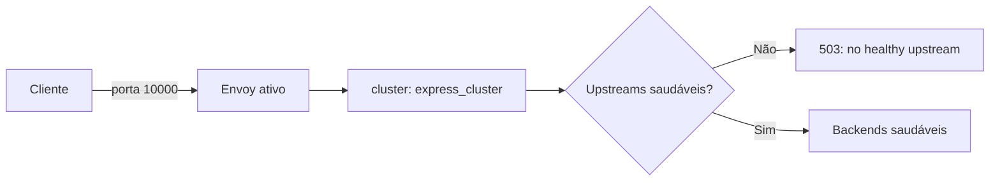

<!-- template: v2 -->

# INC-011 — Bangalore: Envoy Panics

Relatório de incidente simulado no SadServers. As conclusões abaixo distinguem evidências observadas, inferências e verificações não executadas.

## Resumo executivo

O cenário apresentava um proxy Envoy responsável por distribuir requisições entre dois backends Express, ambos configurados para responder HTTP 503 em `/health`. O objetivo era impedir o envio de tráfego a upstreams não saudáveis e obter a resposta `no healthy upstream` em `curl localhost:10000`, sem modificar os backends.

A investigação encontrou um bloqueio anterior à política de *panic mode*: o container Envoy estava reiniciando com código 1 porque a rota referenciava `app_cluster`, enquanto o único cluster declarado era `express_cluster`. Após corrigir a referência e declarar `common_lb_config.healthy_panic_threshold.value: 0`, a configuração passou no validador do Envoy v1.24.0 e o container voltou a executar. A interface oficial do SadServers exibiu `Solution is correct`: **13min48s, zero dicas e dois pontos**.

Não foi preservada uma captura independente da resposta final de `curl localhost:10000`; o cumprimento do critério funcional foi confirmado pelo checker oficial.

## Escopo e critérios de sucesso

- **Cenário:** Bangalore — Envoy Panics; nível Medium; tipo Fix; tempo limite de 15 minutos.
- **Escopo permitido:** configuração e execução do proxy Envoy.
- **Restrição:** não modificar os dois serviços de backend.
- **Critério funcional:** `curl localhost:10000` retornar `no healthy upstream`.
- **Critério de aceite:** checker oficial aprovar a solução.

## Contexto do sistema

O host Linux executava Docker. `express1` e `express2` estavam `Up`, publicados respectivamente nas portas 3001 e 3002 do host, ambas direcionadas à porta 3000 dos containers. O container `envoy` utilizava a imagem `envoyproxy/envoy:v1.24.0` e publicava a porta 10000. Sua configuração era um bind mount somente leitura de `/home/admin/envoy.yaml` para `/etc/envoy/envoy.yaml`.

O arquivo declarava um listener HTTP na porta 10000, um cluster `express_cluster` com balanceamento `round_robin`, endpoints `express1:3000` e `express2:3000`, e health checks HTTP em `/health` com status esperado 200. A rota, contudo, apontava para `app_cluster`.

## Sequência cronológica da investigação

1. **Linha de base HTTP:** `curl -i --max-time 5 http://localhost:10000/` retornou `Connection refused`.
2. **Descoberta do runtime:** `systemctl status envoy` indicou ausência da unidade `envoy.service`. `ss -lntp` mostrou portas 3001 e 3002, mas não 10000. `docker ps -a` revelou `express1` e `express2` em execução e `envoy` em `Restarting (1)`.
3. **Diagnóstico de inicialização:** `docker logs --tail 80 envoy` apresentou `route: unknown cluster 'app_cluster'`. `docker inspect` confirmou o bind mount de `/home/admin/envoy.yaml`.
4. **Inspeção da configuração:** `cat /home/admin/envoy.yaml` revelou a divergência entre `route.cluster: app_cluster` e `clusters[].name: express_cluster`. Também não havia uma política explícita de *panic threshold*.
5. **Preparação:** foi criado `/home/admin/envoy.yaml.bak` com `cp`; o backup foi posteriormente sobrescrito por uma segunda execução do mesmo comando, antes da correção efetiva.
6. **Tentativa de edição:** uma sessão do Nano foi suspensa (`Stopped`, recuperável com `fg`). A primeira validação ainda encontrou `app_cluster`; a leitura posterior com `grep` confirmou que as edições pretendidas não estavam persistidas.
7. **Correção persistida:** `sed -i` substituiu a referência da rota por `express_cluster` e inseriu `common_lb_config` com `healthy_panic_threshold.value: 0` após `lb_policy: round_robin`.
8. **Validação estática:** a execução isolada de Envoy v1.24.0 com `--mode validate -c /etc/envoy/envoy.yaml` terminou com `configuration '/etc/envoy/envoy.yaml' OK`.
9. **Aplicação:** `docker restart envoy` concluiu; `docker ps --filter name=envoy` exibiu `Up 5 seconds` e publicação `0.0.0.0:10000->10000/tcp`.
10. **Aceite:** a interface do SadServers exibiu `Solution is correct`, 13 minutos e 48 segundos, zero dicas e dois pontos.

## Hipóteses e evidências

| ID | Hipótese | Evidência | Conclusão |
|---|---|---|---|
| H1 | Envoy não estava aceitando conexões na porta 10000 | `curl`: conexão recusada; `ss`: porta ausente | Confirmada na linha de base |
| H2 | Envoy era gerenciado pelo systemd | `envoy.service could not be found`; container Docker encontrado | Não sustentada |
| H3 | Referência inválida ao cluster impedia a inicialização | Logs: `route: unknown cluster 'app_cluster'`; YAML declara `express_cluster` | Confirmada |
| H4 | Política padrão de panic mode precisava ser alterada | Enunciado descreve dois backends não saudáveis e encaminhamento indevido; YAML sem threshold explícito | Requisito de remediação sustentado pelo cenário |
| H5 | Edição inicial foi persistida | `grep` e validador ainda mostravam `app_cluster`, sem `healthy_panic_threshold` | Refutada |
| H6 | Configuração final é aceita pelo Envoy | `--mode validate` retornou `configuration ... OK` | Confirmada |

## Causa raiz e fatores contribuintes

**Bloqueio de inicialização confirmado:** a rota HTTP referenciava `app_cluster`, inexistente entre os clusters configurados. O Envoy rejeitou a configuração e o container reiniciava continuamente, impedindo conexões na porta 10000.

**Comportamento de roteamento exigido pelo cenário:** a política padrão de *panic mode* podia encaminhar tráfego para hosts não saudáveis quando a fração de hosts saudáveis ficasse abaixo do limite. O cenário solicitava impedir esse encaminhamento, mantendo os health checks e os backends inalterados. Foi configurado o threshold em 0%.

**Fator operacional:** a edição inicial no Nano não foi persistida, exigindo verificação do arquivo em disco e uma nova correção. O backup `.bak` foi criado, mas sua restauração não foi testada.

## Registro de decisões

| Decisão | Ação | Justificativa |
|---|---|---|
| DEC-001 | Observar HTTP e serviço antes de intervir | Estabelecer a linha de base |
| DEC-002 | Investigar portas e containers Docker | Identificar o runtime real |
| DEC-003 | Ler logs e mounts do Envoy | Localizar a falha de inicialização e o arquivo efetivo |
| DEC-004 | Inspecionar YAML e bindings antes da edição | Distinguir rota, cluster e exposição da porta |
| DEC-005 | Corrigir referência e política de panic mode sem tocar nos backends | Atender ao requisito com intervenção restrita ao proxy |
| DEC-006 | Verificar arquivo persistido após edição frustrada | Evitar assumir que alterações no editor foram gravadas |
| DEC-007 | Validar configuração com a mesma versão do Envoy antes do restart | Reduzir risco de reinício com YAML inválido |
| DEC-008 | Reiniciar apenas o container Envoy e solicitar validação funcional | Aplicar a configuração preservando os backends |

## Remediação e rollback

A configuração de rota passou a apontar para o cluster declarado:

```yaml
route:
  cluster: express_cluster
```

No cluster `express_cluster`, foi acrescentada a política:

```yaml
lb_policy: round_robin
common_lb_config:
  healthy_panic_threshold:
    value: 0
```

Os endpoints e o health check `/health` foram mantidos. A configuração completa final não foi arquivada como artefato independente; os trechos acima refletem os comandos aplicados e o `grep` posterior.

**Aplicação:** validação com a imagem `envoyproxy/envoy:v1.24.0`, seguida de `sudo docker restart envoy`.

**Rollback planejado, não executado:** restaurar o arquivo de backup após inspecionar seu conteúdo, validar a configuração restaurada e reiniciar o Envoy. O backup foi sobrescrito uma vez durante a investigação; seu conteúdo final não foi auditado. Restaurá-lo provavelmente reintroduziria a falha original, portanto não constitui por si só um rollback seguro para produção.

## Matriz de validação

| Critério | Evidência | Resultado |
|---|---|---|
| Backends não modificados | Nenhum comando de alteração nos containers Express foi registrado | Sem intervenção observada |
| Rota aponta para cluster existente | `grep` exibiu `cluster: express_cluster` e `name: express_cluster` | Aprovado |
| Threshold de panic configurado | `grep` exibiu `common_lb_config` e `healthy_panic_threshold` | Aprovado |
| Configuração sintática/semanticamente aceita | `configuration '/etc/envoy/envoy.yaml' OK` | Aprovado |
| Container Envoy inicia | `docker ps`: `Up 5 seconds` | Aprovado no instante observado |
| Porta 10000 publicada | `docker ps`: `0.0.0.0:10000->10000/tcp` | Aprovado |
| Resposta direta `no healthy upstream` | Saída final de `curl` não capturada na conversa | Não observado diretamente |
| Checker oficial | `Solution is correct` | Aprovado |
| Estabilidade prolongada | Não foi capturada medição após intervalo prolongado | Não executado |
| Teste de rollback | Nenhuma restauração executada | Não executado |

## Architecture Review — As-Is vs. To-Be

**As-Is observado:**

```mermaid
flowchart LR
    C[Cliente] -->|localhost:10000| E[Envoy reiniciando]
    E -.->|rota: app_cluster inexistente| X[Falha de configuração]
    B1[express1:3000] --> HC[/health: 503]
    B2[express2:3000] --> HC
```

**To-Be aplicado:**



A configuração aplicada define `healthy_panic_threshold: 0`, evitando que o modo de pânico inclua hosts não saudáveis. Os diagramas são representações conceituais da investigação, não capturas da configuração completa.

## Lições aprendidas e ações preventivas

- Confirmar o runtime antes de presumir gerenciamento por systemd.
- Validar referências cruzadas entre rotas e clusters antes de aplicar configuração do Envoy.
- Definir explicitamente o comportamento esperado quando nenhum upstream estiver saudável.
- Tratar `--mode validate` como controle pré-restart, sem confundi-lo com teste funcional.
- Confirmar alterações no arquivo persistido após sessões interrompidas de editor.
- Manter backups versionados ou com timestamp; evitar sobrescrever a única cópia.
- Capturar o resultado de `curl -i localhost:10000` e métricas de health dos upstreams em execuções futuras.

## Limitações

O aceite oficial confirma os critérios do laboratório, não a adequação automática da configuração para produção. Não foi capturada a resposta HTTP final no terminal, nem foi realizado teste prolongado de estabilidade, teste de rollback ou auditoria integral do arquivo final. O resultado inicial de saúde dos backends deriva do enunciado do cenário; não houve inspeção independente dos endpoints `/health` na investigação registrada.

## Referências

- SadServers — cenário **Bangalore: Envoy Panics** (enunciado e checker oficial, execução de 18/10/2026).
- Logs e comandos executados no ambiente de laboratório, conforme transcrição da investigação.
- Envoy Proxy — documentação de health checking e configuração de load balancing: https://www.envoyproxy.io/docs/envoy/latest/intro/arch_overview/upstream/health_checking e https://www.envoyproxy.io/docs/envoy/latest/api-v3/config/cluster/v3/cluster.proto
