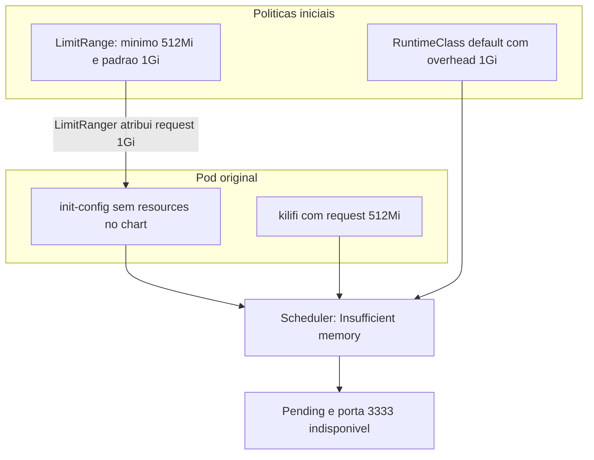
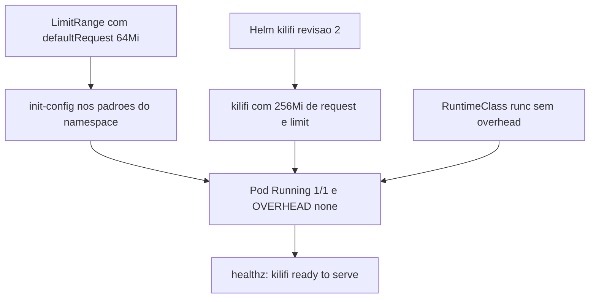

<!-- template: v2 -->

# INC-012 — Kilifi: Speculative Misallocation!

Relatório de laboratório simulado. A primeira linha deste arquivo é o marcador da versão e permanece na primeira linha.

## Resumo executivo

**Ambiente:** SadServers — Kilifi, Debian 13, K3s e Helm. Laboratório simulado e efêmero.

**Dificuldade do laboratório:** Medium.

**Status:** Resolvido na segunda tentativa — checker local e interface oficial aprovados.

**Severidade:** Não atribuída. Não há medição de usuários ou de serviço de produção.

A release Helm `kilifi`, no namespace `default`, deixava o Pod em `Pending`. O scheduler registrava `0/1 nodes are available: 1 Insufficient memory`. O HTTP na porta `3333` não ficava disponível.

Havia duas políticas de memória incompatíveis com o nó `node1`, cuja memória alocável era de aproximadamente `940MiB`:

- o `LimitRange` do namespace aplicava request e limit padrão de `1Gi` a container sem recursos declarados, e exigia mínimo de `512Mi`;
- a `RuntimeClass` `default` acrescentava overhead fixo de `1Gi` por Pod.

O init container `init-config` não declarava recursos e recebia `1Gi` pela anotação do `LimitRanger`. O container `kilifi` pedia `512Mi`. Na primeira tentativa, reduzir os requests dos containers não agendou o Pod: o overhead continuou no cálculo. A conta registrada ficou em `256Mi` dos containers mais `1024Mi` de overhead, total `1280Mi`. O overhead foi removido, mas o laboratório expirou antes de recriar o Pod e de testar o serviço.

A segunda tentativa começou numa instância nova, com as mesmas políticas e o Pod original em `Pending`. O `LimitRange` e a `RuntimeClass` foram corrigidos antes do upgrade. O Helm publicou a revisão 2 com request e limit de `256Mi` na aplicação. O Pod `kilifi-7568dfdfc8-lvhgp` ficou `Running`, `1/1`, no `node1`, sem reinícios e sem overhead. `/healthz` respondeu `kilifi ready to serve`. O checker local retornou `OK`. A interface confirmou `Solution is correct`.

Tempo oficial da tentativa bem-sucedida: 4 minutos e 1 segundo, sem dicas, com 2 pontos. Foram duas tentativas. A primeira não comprovou recuperação.

## Escopo e critérios de sucesso

**Escopo:** disponibilizar a aplicação `kilifi` no namespace `default`, no nó `node1`, sem aumentar a memória do nó e sem habilitar swap.

**Fora do escopo registrado:** aumentar a capacidade do nó, habilitar swap, medir consumo sob carga, inventariar outros workloads e executar rollback.

**Critérios registrados como atendidos na tentativa 2:**

- Release Helm `kilifi` com `STATUS: deployed`, revisão 2.
- Pod agendado no `node1`, `Running` e `1/1 Ready`.
- Ausência de overhead de memória nesse Pod.
- `/healthz` com `kilifi ready to serve`, no acesso esperado pela porta `3333`.
- Checker local `/home/admin/agent/check.sh` com `OK`.
- Interface do SadServers com `Solution is correct`.

O Deployment com uma réplica disponível era critério do cenário. A linha de status do Deployment não foi transcrita. A evidência registrada é um Pod `1/1 Ready` e a release na revisão 2.

O swap deveria permanecer desabilitado. Nenhum comando de verificação do swap foi registrado.

## Contexto do sistema

| Componente | Observação |
|---|---|
| Cenário | SadServers — Kilifi: Speculative Misallocation! |
| Plataforma | Debian 13, K3s |
| Nó | `node1`; memória alocável aproximada de `940MiB` |
| Namespace | `default` |
| Release | Helm `kilifi`, chart local `charts/kilifi` |
| Init container | `init-config`, arquivo `/srv/kilifi/config.json` |
| Aplicação | container `kilifi`, HTTP na porta `3333` |
| Request original da aplicação | `512Mi` |
| Init no chart original | sem recursos declarados |
| `LimitRange` inicial | mínimo `512Mi`; request e limit padrão `1Gi` |
| `RuntimeClass` | nome `default`, handler `runc`, `overhead.podFixed.memory: 1Gi` |
| CoreDNS na tentativa 1 | `70Mi` de request de memória já agendados |
| Checker | `/home/admin/agent/check.sh` |

O nome do Service não foi transcrito. O nome do Pod original, anterior a `kilifi-7568dfdfc8-lvhgp`, também não. Os campos do `LimitRange` fora de `default`, `defaultRequest`, `max` e `min` de memória não foram transcritos. A memória alocável está registrada como aproximada.

Não foram inspecionados outros nós, outros namespaces, métricas de uso real da aplicação nem a condição `MemoryPressure` do nó.

## Sequência cronológica da investigação

Não há horários absolutos dentro de cada tentativa. A ordem abaixo é a das etapas registradas. A tentativa 2 é uma instância nova: as edições da tentativa 1 não estavam presentes nela.

### Tentativa 1

1. O Pod permanecia `Pending`, sem nó. O scheduler informava `0/1 nodes are available: 1 Insufficient memory`.
2. O `LimitRange` exigia mínimo de `512Mi` e aplicava request padrão de `1Gi`. A anotação do Pod mostrou que o `LimitRanger` tinha atribuído recursos ao `init-config`, com request de `1Gi`.
3. A política e o chart foram ajustados: init container com request `64Mi` e limit `128Mi`; aplicação com request `256Mi` e limit `256Mi`. `helm lint` e `helm template` validaram o manifesto.
4. O novo Pod continuou `Pending`. `helm upgrade --wait` foi suspenso no terminal com `Ctrl+Z`. Depois de retomado, terminou por timeout.
5. A `RuntimeClass` `default` tinha `handler: runc` e `overhead.podFixed.memory: 1Gi`. O Pod confirmava `overhead={"memory":"1Gi"}`. A conta registrada do request efetivo foi `256Mi` dos containers, `1024Mi` de overhead e `1280Mi` no total, acima da capacidade alocável aproximada.
6. O overhead foi removido da `RuntimeClass`. O laboratório expirou antes da recriação do Pod e do teste funcional.

**Resultado da tentativa 1:** as duas causas foram identificadas e as alterações foram aplicadas. A recuperação não foi comprovada.

### Tentativa 2

1. A instância nova tinha as mesmas políticas e o Pod original em `Pending`.
2. Foram gravados `/home/admin/kilifi-limitrange-before.yaml` e `/home/admin/kilifi-runtimeclass-before.yaml`.
3. O `LimitRange` passou a declarar, para memória, `default: 128Mi`, `defaultRequest: 64Mi`, `max: 1Gi` e `min: 64Mi`.
4. O overhead foi removido da `RuntimeClass` `default`. O handler `runc` foi mantido.
5. O upgrade foi feito sem `--wait`:

```bash
helm upgrade kilifi charts/kilifi -n default \
  --set resources.requests.memory=256Mi \
  --set resources.limits.memory=256Mi
```

6. O Helm registrou `STATUS: deployed`, revisão 2.
7. O Pod `kilifi-7568dfdfc8-lvhgp` ficou `Running`, `1/1 Ready`, no `node1`, com zero reinícios e `OVERHEAD: <none>`. O init container usou os padrões corrigidos do namespace. Não foi necessária alteração persistente no template local.
8. `/healthz` respondeu `kilifi ready to serve`. `/home/admin/agent/check.sh` retornou `OK`. A interface confirmou `Solution is correct`, em 4m01s, sem dicas e com 2 pontos.

## Hipóteses e evidências

| Hipótese | Teste | Observação | Classificação |
|---|---|---|---|
| H1 — o Pod não agendava por request de memória acima da capacidade | Evento `FailedScheduling` | `0/1 nodes are available: 1 Insufficient memory`; Pod sem nó | Confirmada |
| H2 — o init container recebia recursos pelo `LimitRange` | Anotação `LimitRanger` e leitura da política | Init sem recursos no chart; request atribuído de `1Gi`; mínimo `512Mi` e padrão `1Gi` | Confirmada |
| H3 — reduzir só os requests dos containers bastava | Novo Pod depois do ajuste de `64Mi`/`128Mi` e `256Mi`/`256Mi` | O Pod continuou `Pending` | Afastada como solução suficiente |
| H4 — a `RuntimeClass` acrescentava overhead além dos containers | Manifesto da `RuntimeClass` e `spec.overhead` do Pod | `podFixed.memory: 1Gi` e `overhead={"memory":"1Gi"}` | Confirmada |
| H5 — corrigir `LimitRange` e overhead, e publicar `256Mi` na aplicação, permitiria o agendamento | Upgrade da tentativa 2 e leitura do Pod novo | `kilifi-7568dfdfc8-lvhgp` em `Running`, `1/1`, `OVERHEAD: <none>` | Confirmada na tentativa 2 |
| H6 — o serviço responderia depois do agendamento | `/healthz` e checker local | `kilifi ready to serve` e `OK` | Confirmada na tentativa 2 |

H3 foi testada na tentativa 1. `helm lint` e `helm template` nessa tentativa validaram o manifesto; não provam que o scheduler aceite o Pod. H5 e H6 não foram comprovadas na tentativa 1 porque o laboratório expirou.

Na tentativa 1, o CoreDNS representava `70Mi` de request já agendados. Essa quantidade não entrou na conta de `1280Mi`. A conta registrada já superava os `940MiB` aproximados do nó sem somar o CoreDNS.

**Inferido:** o total de `256Mi` dos containers, e não `256Mi + 64Mi`, é compatível com a regra em que o request de init container não é somado ao dos containers da aplicação. O registro não cita essa regra; a conta apresentada foi `256Mi + 1024Mi`.

## Causa raiz e fatores contribuintes

**Confirmado:** o scheduler recusava o Pod por memória declarada acima da capacidade alocável do único nó visível. Duas políticas compunham essa reserva. O `LimitRange` preenchia o `init-config`, que não declarava recursos, com request de `1Gi`. A `RuntimeClass` `default` acrescentava `1Gi` de overhead, e esse valor entrava no cálculo mesmo depois que os requests dos containers tinham sido reduzidos.

**Confirmado:** a redução isolada dos requests não recuperou o agendamento. Com overhead de `1Gi`, o request efetivo registrado ficou em `1280Mi`, acima de aproximadamente `940MiB`.

**Confirmado na tentativa 2:** com o `LimitRange` reduzido, o overhead removido e a aplicação em `256Mi`, o Pod novo agendou sem overhead e o `/healthz` respondeu.

**Inferido:** o overhead configurado não media o consumo real do processo. O registro não traz métrica de uso da aplicação.

**Não determinado:** quem criou o `LimitRange` e a `RuntimeClass`, nem por quê. Também não foi determinado o consumo real sob carga, o estado do swap por comando, a condição `MemoryPressure` do nó e o efeito das políticas sobre outros workloads.

**Fator contribuinte:** o chart original não declarava recursos no `init-config`, então o padrão do namespace virou request do Pod. Na tentativa 2, o init usou os padrões já corrigidos e o template local não precisou de mudança persistente.

## Registro de decisões

| ID | Contexto ou hipótese | Evidência utilizada | Decisão | Justificativa | Risco ou trade-off | Resultado observado |
|---|---|---|---|---|---|---|
| DEC-001 | Serviço indisponível e Pod não pronto | Pod `Pending` | Ler o evento do scheduler antes de alterar recursos | Separar falha de agendamento de falha da aplicação | A leitura adia a primeira mudança | `Insufficient memory` em `0/1` nós |
| DEC-002 | O request podia não estar só no chart | Evento de memória | Inspecionar `LimitRange` e o manifesto Helm | Achar a origem dos requests do init | O chart renderizado não mostra o que a admissão acrescenta | Anotação `LimitRanger` com request `1Gi` no init |
| DEC-003 | Requests declarados acima do nó | `1Gi` no init e `512Mi` na aplicação; nó com cerca de `940MiB` | Reduzir init para `64Mi`/`128Mi` e aplicação para `256Mi`/`256Mi` | Aproximar a reserva da capacidade | A mudança não inclui o overhead, ainda não inspecionado | `helm lint` e `helm template` passaram; o Pod continuou `Pending` |
| DEC-004 | O primeiro ajuste não agendou | Pod ainda `Pending`; `helm upgrade --wait` suspenso com `Ctrl+Z` e encerrado por timeout | Investigar a falha persistente antes de outro ajuste | Não tratar o timeout como prova de uma terceira causa | O comando suspenso não é uma execução limpa do `--wait` | A investigação seguiu para a `RuntimeClass` |
| DEC-005 | A reserva podia incluir overhead de runtime | Requests de container já reduzidos e Pod ainda `Pending` | Inspecionar a `RuntimeClass` `default` | O scheduler soma overhead ao request dos containers | Olhar só o chart deixaria a segunda causa fora | `podFixed.memory: 1Gi` e `overhead={"memory":"1Gi"}` |
| DEC-006 | Overhead de `1Gi` sozinho excedia o nó | Conta de `1280Mi` contra cerca de `940MiB` | Remover o overhead e manter o handler `runc` | Tirar a reserva fixa que o scheduler considerava | Em produção, remover overhead sem medir o runtime pode subestimar a reserva; aqui o cenário era o laboratório | Na tentativa 1 o lab expirou antes do teste; na tentativa 2 o Pod novo ficou com `OVERHEAD: <none>` |
| DEC-007 | A tentativa 1 não chegou à validação | Causas já vistas e instância expirada | Repetir o cenário corrigindo as duas políticas antes do Helm | Não gastar a janela só no diagnóstico | A instância nova não herda as edições anteriores | Políticas iniciais reproduzidas e depois corrigidas |
| DEC-008 | `--wait` acoplou o upgrade à espera e foi suspenso | Timeout depois do `Ctrl+Z` na tentativa 1 | Na tentativa 2, executar `helm upgrade` sem `--wait` | Publicar a revisão e observar o Pod à parte | Sem `--wait`, o Helm pode ficar `deployed` antes do Pod ficar pronto | Revisão 2 `deployed`; o Pod foi lido em seguida |
| DEC-009 | `Running` não prova o HTTP nem o aceite | Pod `1/1` sem overhead | Testar `/healthz` e o checker local, e conferir a interface | O critério do cenário inclui o serviço | O comando exato do cliente HTTP não foi transcrito | `kilifi ready to serve`, checker `OK` e `Solution is correct` |

DEC-001, DEC-002, DEC-004 e DEC-005 mudam a direção do diagnóstico. DEC-003, DEC-006, DEC-007 e DEC-008 são intervenções ou a forma de republicar. DEC-009 é o aceite funcional. Não há linha para cada leitura intermediária.

## Remediação e rollback

A recuperação comprovada é a da tentativa 2. A tentativa 1 aplicou ajustes equivalentes de recursos e removeu o overhead, sem Pod recriado nem teste funcional nessa instância.

Na tentativa 2, o init container usou os padrões novos do namespace. O `helm upgrade` definiu request e limit de `256Mi` da aplicação por `--set`. Não houve alteração persistente no template local para concluir o cenário.

### LimitRange

Memória declarada depois da correção:

```yaml
default:
  memory: 128Mi
defaultRequest:
  memory: 64Mi
max:
  memory: 1Gi
min:
  memory: 64Mi
```

O bloco é o que foi registrado como alterado. Não é o manifesto integral do `LimitRange`.

### RuntimeClass

O overhead foi removido da `RuntimeClass` `default`. O handler permaneceu `runc`. O manifesto integral depois da edição não foi transcrito. O Pod novo mostrou `OVERHEAD: <none>`.

### Helm

```bash
helm upgrade kilifi charts/kilifi -n default \
  --set resources.requests.memory=256Mi \
  --set resources.limits.memory=256Mi
```

**Executado e validado na tentativa 2:** revisão 2 com `STATUS: deployed`; Pod `kilifi-7568dfdfc8-lvhgp` em `Running` e `1/1`; `/healthz` com `kilifi ready to serve`; checker local `OK`.

### Rollback

Antes das alterações da tentativa 2 foram gravados:

- `/home/admin/kilifi-limitrange-before.yaml`
- `/home/admin/kilifi-runtimeclass-before.yaml`

**Rollback não executado.** Restaurar esses arquivos pode recolocar o mínimo de `512Mi`, o padrão de `1Gi` e o overhead de `1Gi`, e com isso reproduzir o `Pending`. A release Helm também ficaria na revisão publicada, a menos que um `helm rollback` fosse executado. Esse comando não foi registrado.

O `LimitRange` vale para o namespace `default`. A `RuntimeClass` `default` pode alcançar outros Pods que a usem. Nenhum outro workload foi inventariado depois da mudança.

## Matriz de validação

| Critério de sucesso | Estado inicial | Comando ou método | Resultado após a intervenção | Fonte da evidência | Status | Limitação |
|---|---|---|---|---|---|---|
| Release publicada | Pod original `Pending` | `helm upgrade` sem `--wait` | `STATUS: deployed`, revisão 2 | Saída do Helm na tentativa 2 | aprovado | Não prova o HTTP |
| Pod agendado | `Pending`, sem nó, `Insufficient memory` | Leitura do Pod novo | `NODE: node1` | `kilifi-7568dfdfc8-lvhgp` | aprovado | Vale para a tentativa 2 |
| Container pronto | Pod não pronto | Leitura do Pod | `1/1 Ready`, zero reinícios | Mesmo Pod | aprovado | A linha do Deployment não foi transcrita |
| Sem overhead no Pod novo | `overhead={"memory":"1Gi"}` no Pod anterior | Leitura de overhead | `OVERHEAD: <none>` | Pod da tentativa 2 | aprovado | Não mede o consumo real do runtime |
| HTTP do serviço | Serviço indisponível com o Pod `Pending` | `/healthz` na porta `3333` | `kilifi ready to serve` | Resposta registrada | aprovado | O comando do cliente não foi transcrito |
| Checker local | Cenário não aceito | `/home/admin/agent/check.sh` | `OK` | Checker do laboratório | aprovado | Separado da interface |
| Aceite oficial | Cenário em aberto | Interface do SadServers | `Solution is correct` | Interface, 4m01s, 0 dicas, 2 pontos | aprovado | Tempo da tentativa bem-sucedida, não a soma das duas |
| Swap desabilitado | Restrição do cenário | Verificação de swap | Não executado | Plano de não habilitar swap | não executado | Não há comando nem saída |
| Rollback | Backups gravados na tentativa 2 | Restauração | Não executado | Arquivos `.yaml` de backup | não executado | Restaurar as políticas pode recolocar o `Pending` |
| Tentativa 1 | Mesmo sintoma inicial | Ajustes de recursos e remoção do overhead | Lab expirado antes do Pod novo e do `/healthz` | Registro da tentativa 1 | inconclusivo | Causas vistas; recuperação não comprovada |

## Architecture Review — As-Is vs. To-Be

O agendamento depende do request efetivo do Pod, não só da memória pedida pelo container principal. **O To-Be é proposta.** O estado recuperado abaixo foi executado e validado na tentativa 2. Os controles de produção não foram implantados.

### As-Is observado

No estado inicial, o `LimitRanger` completava o init sem recursos e a `RuntimeClass` `default` somava `1Gi` de overhead. O scheduler via um único nó e recusava o Pod.



A seta contínua é relação observada. Depois que os requests dos containers foram reduzidos, o overhead de `1Gi` continuou. A conta registrada passou a `256Mi + 1024Mi = 1280Mi`, acima de aproximadamente `940MiB`. Esse segundo bloqueio também foi observado, na tentativa 1, e não está desenhado como se o request original de `512Mi` ainda estivesse ativo nessa conta.

Na tentativa 1, o CoreDNS já ocupava `70Mi` de request. Não há desenho de outros controladores: não foram inventariados.

### Estado recuperado

Fluxo executado e validado na tentativa 2. Não é proposta.



O checker local e a interface ficam fora do desenho. Eles confirmam o critério do laboratório; não descrevem o cálculo do scheduler.

### To-Be proposto

- Medir o overhead real do runtime antes de fixar `podFixed`, e antes de removê-lo num cluster compartilhado.
- Declarar requests e limits no chart, inclusive no init container, para o Pod não depender do padrão do namespace.
- Tratar `LimitRange` e `RuntimeClass` como política da plataforma, com dono e revisão. A mudança feita aqui vale para o namespace `default` e para quem usar a `RuntimeClass` `default`.
- Separar políticas por namespace quando workloads tiverem reservas diferentes.
- Completar a validação com a linha do Deployment, o comando do `/healthz`, a verificação de swap e um teste de que outros Pods continuam agendáveis.
- Não tratar `256Mi` como capacidade medida. Esse valor segue a recomendação do cenário. Não houve série de uso sob carga, nem para a aplicação nem para o init.

Nenhum desses controles foi implantado. Não foi criado runbook: o repositório só admite procedimento depois de validação prática, e o To-Be não foi executado.

## Lições aprendidas e ações preventivas

- O request que o scheduler usa não é só o do container principal. Init container sem recursos e overhead de `RuntimeClass` entram na conta.
- `Insufficient memory` com `0/1 nodes` foi o bloqueio registrado. A condição `MemoryPressure` do nó não foi lida. Ausência dessa leitura não significa que o nó estivesse sem pressão, nem o contrário.
- O objeto criado pela admissão pode diferir do chart. A anotação `LimitRanger` mostrou o request que o init não declarava.
- `helm lint` e `helm template` não agendam o Pod. O primeiro ajuste deixou o Pod em `Pending`.
- Remover uma causa pode revelar a seguinte. O overhead só ficou visível como bloqueio restante depois da redução dos containers.
- `Running` não substitui `/healthz` nem o checker. Na tentativa 2, os três foram observados: Pod pronto, resposta do health e `OK` do script.
- `helm upgrade --wait`, quando suspenso com `Ctrl+Z`, não serviu como observação limpa do rollout. Na tentativa seguinte, publicar e ler o Pod foram passos separados.
- As ações do To-Be permanecem proposta. A correção validada é a do laboratório de nó único.

## Limitações

- A tentativa 1 identificou as causas e aplicou mudanças, mas expirou antes do Pod recriado e do teste funcional.
- A tentativa 2 é outra instância. O tempo de 4m01s, as zero dicas e os 2 pontos referem-se a essa tentativa.
- A memória alocável de `940MiB` está registrada como aproximada. A conta de `1280Mi` é a explicação registrada a partir do overhead e dos requests, não um `kubectl describe node` transcrito por completo.
- A regra do scheduler sobre init container e a soma dos containers da aplicação não foi citada no registro. A compatibilidade com o total de `256Mi` é inferida.
- Não foram transcritos o nome do Service, o comando do cliente HTTP, a linha de status do Deployment, o manifesto integral do `LimitRange` nem o da `RuntimeClass` depois da edição.
- `MemoryPressure` e o estado do swap não foram verificados por comando.
- Não há métrica de carga da aplicação nem do init. `256Mi` é o valor pedido pelo cenário.
- O efeito sobre outros workloads do namespace `default` ou da `RuntimeClass` `default` não foi inventariado.
- O rollback não foi executado.
- Não há impacto medido fora do laboratório. Medium é a classificação do cenário.

## Referências

- SadServers — Kilifi: Speculative Misallocation!
- Release Helm `kilifi`, chart local `charts/kilifi`, revisão 2.
- Políticas do laboratório: `LimitRange` do namespace `default` e `RuntimeClass` `default`.
- Backups da tentativa 2: `/home/admin/kilifi-limitrange-before.yaml` e `/home/admin/kilifi-runtimeclass-before.yaml`.
- Pod validado: `kilifi-7568dfdfc8-lvhgp`.
- Checker local: `/home/admin/agent/check.sh`.
- Interface do SadServers: `Solution is correct`, 4m01s, 0 dicas, 2 pontos.
- [Metodologia de investigação](../../docs/methodology.md).
- [Checklist de qualidade dos incidentes](../../docs/incident-quality-checklist.md).
- [Modelo de relatório v2](../../templates/incident-report.md).
- [Catálogo técnico](../README.md).
